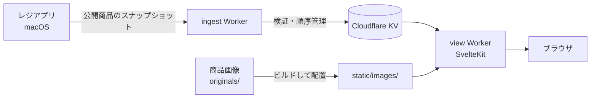

# Craftill

フリマで **1人・Mac 1台** で使うレジアプリと、商品と在庫を公開する Web アプリです。

| 構成 | 役割 |
| --- | --- |
| **レジアプリ**（macOS / SwiftUI） | 商品の読み取り、会計、在庫管理、販売記録。端末内の SQLite がデータの正 |
| **在庫表示 Web**（SvelteKit / Cloudflare Workers） | レジから送られた公開商品のスナップショットを、来場者向けに表示 |

現金会計は通信なしで完結します。Web への送信は付随機能で、送信できなくてもレジは止まりません。

---

## 特長

### レジアプリ

- **会計**：現金、Lightning（sats）、現金＋sats の併用に対応
- **商品の追加**：QR 読み取り、商品IDの手入力、商品パネル、野良商品（登録外）の追加
- **在庫管理**：数量管理・一点物・在庫管理なしの3モード。販売・取消・調整を在庫変動として記録
- **販売管理**：販売履歴、販売取消、返金済みフラグ、日次・期間集計、現金照合
- **商品マスタ**：グループ・種類・商品の編集、CSV 取り込み／書き出し、価格一覧
- **QR ラベル**：商品IDの QR を任意枚数生成して印刷
- **エクスポート**：販売・在庫・精算・sats 照合などを CSV で出力
- **PIN ロック**：起動時と、取消・在庫調整・CSV 再取り込み・エクスポートなどで PIN を要求
- **画像**：撮影・選択した写真を外部フォルダへ `<商品ID>.jpg` で保存
- **公開サイト連携**：公開商品のスナップショットを手動または自動で送信

Lightning 決済は **Wallet of Satoshi などを手動で操作**して受け取ります。アプリは請求額の表示と、入金確認後の会計確定を担当します。レート換算はせず、sats 価格は商品ごとに事前登録した値を使います。

### 在庫表示 Web

- 公開商品を**種類ごと**に一覧表示
- 在庫に応じて「残り N 個」「1点もの」「SOLD OUT」を表示
- 「すべて / 在庫あり / SOLD OUT」で絞り込み
- 商品画像は `<商品ID>.jpg` を参照。画像が無い場合は商品名と属性を表示
- 最終更新時刻と画像の版識別子を表示
- 開発サーバーでは、KV が無くてもデモデータで表示を確認できる

---

## 全体構成

```text
Craftill/
├── Craftill/                      # レジアプリ（macOS / SwiftUI）
│   ├── Craftill.xcodeproj/
│   └── Craftill/                  # Swift ソース
│       ├── UI/                    # 画面
│       ├── Persistence.swift      # SQLite
│       ├── Types.swift            # データ型
│       ├── SnapshotSender.swift   # 公開サイトへの送信
│       └── ...
├── web/
│   ├── flea-inventory-ingest/     # スナップショット受信 Worker
│   │   └── src/index.js           # KV 書き込み・順序管理
│   └── flea-inventory-view/       # 在庫表示 Web（SvelteKit）
│       ├── src/routes/            # 画面と /api/snapshot
│       └── static/images/         # Web 用の商品画像
├── scripts/
│   ├── build_images.py            # 商品画像のビルド
│   └── build_images.sh
├── originals/                     # 商品画像の原本（コミットしない）
└── docs/                          # 設計メモ（講座資料はアプリ仕様ではない）
```

### データの流れ



- レジの販売・在庫データは、まず端末内 SQLite に保存されます。
- Web に送るのは**公開商品のスナップショットだけ**です。販売履歴や画像データは送りません。
- 画像はアプリから送らず、開発者が Web の静的ディレクトリへ配置します。

---

## はじめかた

### レジアプリ

必要なもの：

- macOS 27 以降（プロジェクトの Deployment Target は macOS 27）
- Xcode 27 以降

```sh
open Craftill/Craftill.xcodeproj
```

Xcode で `Craftill` スキームを選び、実行先を **My Mac** にして Run してください。外部ライブラリの追加は不要です。

初回起動時は PIN を設定します。商品が空の場合は、機能メニューの「商品マスタ」から登録するか、CSV を取り込んでください。デバッグビルドでは確認用のテスト商品が最初から入ります。

端末内データベースの場所：

```text
~/Library/Application Support/Craftill/craftill.sqlite
```

### 在庫表示 Web（ローカル）

必要なもの：Node.js と npm

```sh
cd web/flea-inventory-view
npm install
npm run dev
```

`npm run dev` では KV が無いため、取得に失敗するとデモデータで表示されます。本番に近い形で確認する場合：

```sh
npm run check
npm run build
npm run preview
```

### Cloudflare へデプロイ

受信 Worker と表示 Web は、同じ KV ネームスペースを共有します。別の環境にデプロイする場合は、`web/flea-inventory-ingest/wrangler.jsonc` と `web/flea-inventory-view/wrangler.jsonc` の KV ID を自分のものに置き換えてください。

#### 1. 受信 Worker

```sh
cd web/flea-inventory-ingest
npx wrangler secret put WRITE_SECRET
npx wrangler deploy
```

`WRITE_SECRET` は、レジアプリが送信時に使う認証トークンです。十分に長いランダムな文字列を設定してください。

#### 2. 在庫表示 Web

受信 Worker のディレクトリにいる場合は、同階層の表示 Web へ移動します。

```sh
cd ../flea-inventory-view
npm ci
npm run build
npx wrangler deploy
```

---

## レジアプリと Web の連携

1. レジアプリの **機能メニュー → 連携・バックアップ・保守 → 公開サイトへ送信** を開きます。
2. 受信エンドポイントに、ingest Worker の `/ingest` を指定します。

   ```text
   https://<ingest-worker>.workers.dev/ingest
   ```

3. 認証トークンに、Worker に設定した `WRITE_SECRET` と同じ値を入力します。
4. 「公開サイトへ送信」で手動送信するか、自動送信を有効にします。

自動送信は、会計・取消・在庫調整・商品編集などのあと、最後の変更から約10秒待って1回だけ送ります。通信できないときは保留し、回復後に送信します。

### 送信されるデータ

```json
{
  "created_at": "2026-11-29T12:34:56.789Z",
  "revision": 42,
  "types": [
    {
      "type_id": "sticker",
      "name": "ステッカー",
      "stock_mode": "counted",
      "attr_labels": ["色", "模様"]
    }
  ],
  "products": [
    {
      "product_id": "ST-001",
      "type_id": "sticker",
      "name": "ステッカー まる",
      "price_jpy": 300,
      "price_sats": 500,
      "attrs": ["黄", "まる"],
      "stock": 10,
      "has_image": true
    }
  ]
}
```

- 送信対象は `is_public` が有効な商品だけです。
- グループ、野良商品、販売履歴、画像データは含まれません。
- 受信側は `created_at` と `revision` の順で新旧を判定します。古いスナップショットは `409 Stale` として拒否されます。
- `/init` は、順序情報を失ったときの復旧用エンドポイントです。通常の送信には使いません。

---

## 商品の種類と在庫

商品は必ず「種類」に属し、種類ごとに在庫の扱いを決めます。

| `stock_mode` | 意味 | 在庫 |
| --- | --- | --- |
| `counted` | 数量管理型 | 0 以上の整数。販売のたびに減る |
| `unique` | 一点物型 | 0 か 1。カート数量は常に1 |
| `none` | 在庫管理なし型 | 在庫を持たない。SOLD OUT にならない |

現在庫は `products.stock` が正で、`stock_movements` は増減の履歴です。会計確定時に、販売・明細・在庫・在庫変動を1つのトランザクションで保存します。

---

## 商品画像

### レジ側

- 商品編集画面の「写真を追加」で撮影・選択した写真は、切り取りと JPEG 変換（長辺1600px）を行い、保存先フォルダへ **`<商品ID>.jpg`** で保存します。
- 保存先フォルダは、初めて「写真を追加」を押したときに選びます。レジだけで使うならどのフォルダでも構いません。
- 「機能メニュー → 商品マスタ → 画像の保存先」でいつでも変更できます。
- レジは表示のたびにフォルダから `<商品ID>.jpg` を直接読みます。手で画像を置く場合も、同じ名前にすれば取り込み操作なしで表示されます。
- 差し替えると同名で上書きされ、「写真を削除」でフォルダのファイルも消えます。写真が無い商品も登録・販売できます。
- アプリ内にはコピーを作りません。旧版がアプリ内に残した写真はそのまま表示され、「画像の保存先」画面からまとめて書き出せます。

### Web 側

ファイル名が `<商品ID>.jpg` に固定されているため、商品IDさえあれば画像のパスは一意に決まります。商品マスタとの対応表は不要です。

1. 保存先フォルダの画像を `web/flea-inventory-view/static/images/` にコピーする
2. サイトは `/images/<商品ID>.jpg` を参照する
3. 画像を追加・差し替えたら、ビルドと再デプロイを行う

```sh
cd web/flea-inventory-view
npm run build
npx wrangler deploy
```

デプロイ済みのサイトは、ローカルのファイルを置き換えただけでは更新されません。Worker はビルド済みの `.svelte-kit/cloudflare` を配信するため、画像の追加・差し替え後は必ず再ビルドと再デプロイを実行してください。

画像が無い商品は、商品名と属性の文字表示にフォールバックします。

### 画像ビルドスクリプト（任意）

`scripts/build_images.py` を使うと、原本からレジ用・Web 用の画像をまとめて生成できます。上の「フォルダを直接読む」運用だけなら不要です。

入力：

- **原本画像**：`originals/<商品ID>.<拡張子>`（`--originals` で変更可）
- **商品マスタ CSV**：アプリの「CSV 取り込み・書き出し」で書き出したもの（`product_id` 列で突合）
- **環境**：Python 3 と macOS 標準の `sips`

```sh
# 既定の originals/ から生成する場合
python3 scripts/build_images.py \
  --csv ~/Downloads/products.csv \
  --web-out web/flea-inventory-view/static/images
```

`--web-out` を省略すると `web/public/images` に出力されます。このリポジトリの Web アプリは `web/flea-inventory-view/static/images` を配信するため、上のように指定してください。

> **出力先の既存画像について**
> `build_images.py` は、前回の `manifest.csv` に「生成済み」として記録されている画像だけを後始末の対象にします。商品マスタから消えた商品の画像は自動で削除しますが、手動で置いた画像や、商品マスタに残っている商品の画像は削除しません。商品マスタに残っている商品の原本が読めない場合も、前回生成した画像を保持します。ただし、初回実行時など `manifest.csv` が無い場合は過去の生成物を特定できないため、古い画像が残ることがあります。その場合は出力先を確認して手動で削除してください。

主な出力：

- `Craftill/Craftill/Images/<商品ID>.jpg` — レジ同梱用サムネイル（JPEG・長辺600px）
- `web/flea-inventory-view/static/images/<商品ID>.jpg` — Web 用画像（JPEG・長辺1200px）
- `web/flea-inventory-view/static/images/manifest.csv` — 商品IDごとの画像有無と原本ハッシュ
- `Craftill/Craftill/ImageBuildInfo.swift` と `web/flea-inventory-view/static/images/version.txt` — アプリと Web の画像版を照合するための識別子

`--strict` を付けると、原本の欠落・余剰・読み込めない画像などがある場合に終了コード 1 を返します。原本はコミットしません（`originals/` は `.gitignore` 対象）。原本は別の場所へバックアップしてください。

---

## データとバックアップ

- 販売・在庫・商品マスタの正は、端末内の SQLite です。Web 側は表示用のコピーです。
- 現金会計は通信なしで動きます。
- 端末が壊れるとデータも失われるため、営業後はこまめにエクスポートしてください。
- エクスポートには販売履歴・販売明細・在庫変動・送信ログも含まれますが、アプリで再取り込みできるのは商品マスタ（グループ・種類・商品）だけです。販売履歴と在庫変動は CSV から復元できません。
- 完全なバックアップには、アプリを終了したうえで `~/Library/Application Support/Craftill/craftill.sqlite` をコピーしてください。CSV だけでは販売履歴・在庫変動までは戻せません。
- PIN と送信トークンは Keychain に保存します。Worker の `WRITE_SECRET` は漏えい時に再発行してください。

---

## 開発の入口

| 場所 | 内容 |
| --- | --- |
| `Craftill/Craftill/` | レジアプリ本体 |
| `Craftill/Craftill/UI/` | 画面と ViewModel |
| `web/flea-inventory-ingest/src/index.js` | スナップショットの受信・検証・順序管理 |
| `web/flea-inventory-view/src/` | 在庫表示 Web |
| `scripts/build_images.py` | 商品画像のビルド |
| `docs/開発/` | 設計メモ・決定事項 |

`docs/使い方講座/` は学習用の教材で、アプリの仕様ではありません。

ライセンスは [Apache License 2.0](LICENSE.txt) です。
