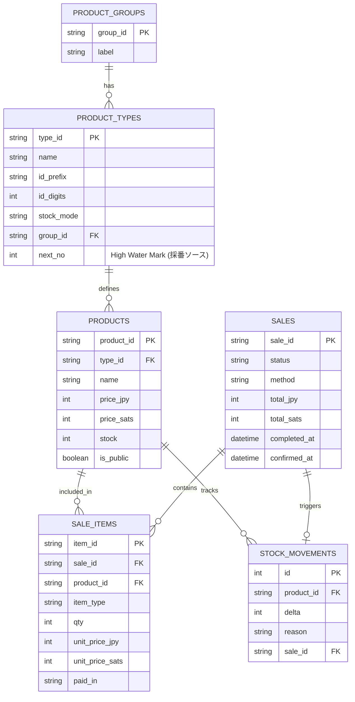
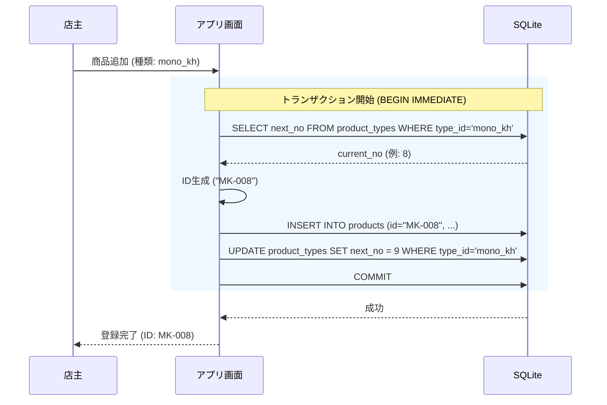
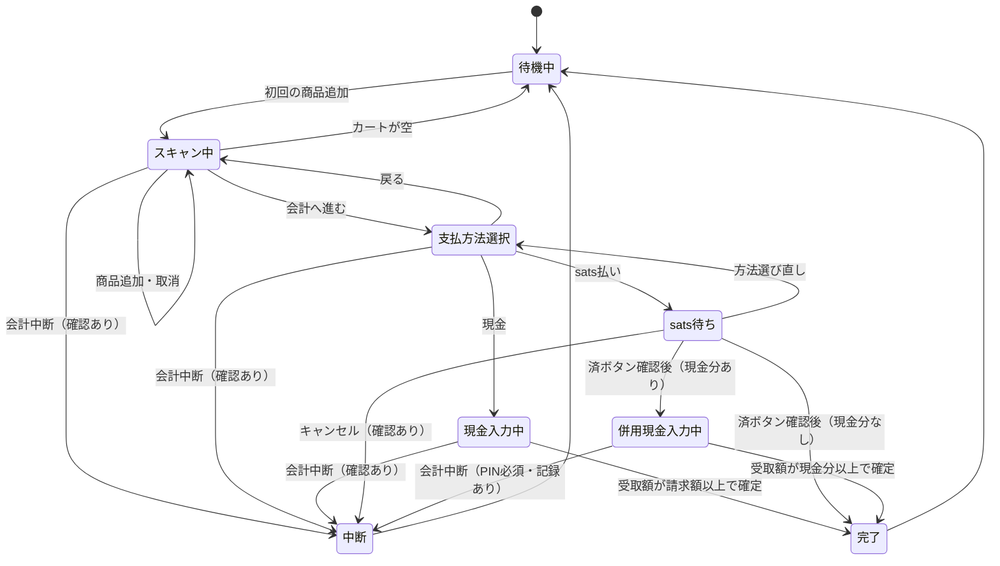

# 実装用の設計図

### 1. データモデル (ER図)
`product_types` テーブルが `next_no`（高水位）を保持し、採番のソースとなる点を明示しています。



### 2. 商品追加・採番シーケンス
`next_no` を読み取り、商品を挿入し、`next_no` をインクリメントする一連の処理が**単一トランザクション**で行われることを示しています。これにより、競合や欠番の不正利用を防ぎます。



### 3. システム構成図
MacBook Neo内で完結する領域と、手動連携（WoS）、非同期連携（Cloudflare）の境界を定義します。

```mermaid
flowchart TB
    subgraph Neo[MacBook Neo (Offline First)]
        App[レジアプリ]
        DB[(SQLite\nnext_no管理)]
        Cam[内蔵カメラ]
        UI[タッチ-less UI]
        File[画像リソース\n(ビルド時同梱)]
    end

    subgraph External[外部連携]
        WoS[WoS App\n(自己管理型)]
        CF[Cloudflare KV\n(公開用)]
        DevMac[開発用Mac\n(画像ビルド)]
    end

    User((店主))
    Customer((客))

    User -- "操作/QRスキャン" --> Neo
    Customer -- "現金/sats支払い" --> User
    
    App -- "Read/Write" --> DB
    App -- "スキャン" --> Cam
    App -- "表示" --> UI
    
    App -. "クリップボード\n(sats額)" .-> WoS
    App -. "目視確認\n(Invoice/入金)" .-> WoS
    
    App -- "スナップショット送信\n(HTTPS/Secret)" --> CF
    DevMac -- "画像デプロイ\n(手動)" --> CF
    
    DevMac -- "原本画像" --> File
```

### 4. 会計状態遷移図
仕様書 A-4 に基づく状態遷移です。`sats確認済み` という状態が、中断時の挙動（記録を残す）にどう影響するかを構造化しています。


