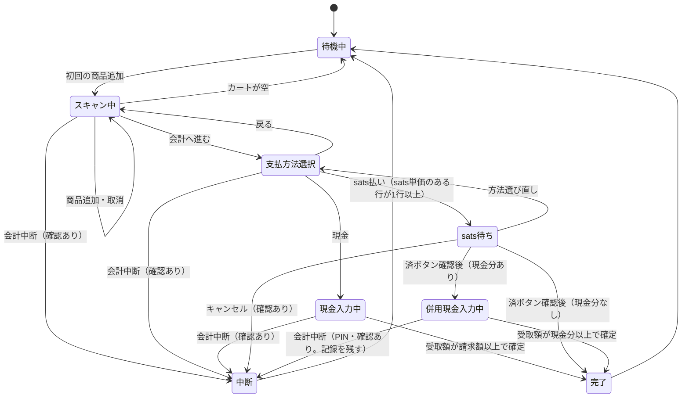

# フリマ用レジ・在庫管理システム 要件（MacBook Neo 1台・1人運用・ネイティブ）

## 0. 前提

| 項目 | 内容 |
| --- | --- |
| 運用者 | 1人（店主＝売り子＝責任者＝開発者）。レジ操作、WoSでの入金確認、アプリ開発を本人が行う |
| 主機能 | レジ・在庫管理（A）。現金会計は通信不要 |
| 付随機能 | 公開Webアプリ（B）。Aの在庫情報を表示するだけ。無くてもAは成立する。更新遅延を許容。Aからの反映手段は Cloudflare KV |
| 運用端末 | MacBook Neo 1台（レジアプリ、カメラ読み取りを同居。WoSの置き場所は Q5）。iPad は任意（同一ソースから iPad 版もビルドできる構成にする。A-16）。Neo の仕様：チップ A18 Pro、メモリ8GB、タッチパネルなし、内蔵カメラは画面側の1台（背面カメラの記載は見つからず。E） |
| 通信手段 | スマホのテザリング（sats決済・Bへの送信用） |
| WoS本体の導入先 | App Store記載は iPhone専用（対応端末：iPhone、Mac（M1以降）、Vision）。Neo（A18 Pro）に導入できるかは未確認。iPad への導入は、手元のiPad所持者からの伝聞で「App Storeから入手可能」（未確認）。置き場所の候補：①Neoに直接 ②iPhoneに置き、iPhoneミラーリングでNeoに表示 ③iPhoneを直接操作。いずれも要確認（Q5） |
| WoSのモード | 日本で提供が確認できているのは自己管理型（公式FAQ：自己管理型は全地域、カストディ型は対応地域のみ）。自己管理型を前提とする（Q6） |
| 価格 | 登録商品：円価格・sats価格を商品ごとに事前確定し、おしながきで周知済み（sats価格は空にでき、空の商品はsats払いでも現金で受け取る。A-6-1）。営業中の改定・セット割なし。レジはレート換算を行わない。野良商品（登録外）：営業中に金額を入力（A-1）。上限なし |
| 商品画像 | ビルド時にアプリへ同梱（A-1）。実行時の取り込み・差し替えは行わない。原本からの生成は画像ビルドスクリプト（A-17）。原本は、データ作成ツール（A-18）が商品IDと同名で作成する（手作業でも可） |
| データ作成 | 商品データ（商品ID・原本画像のファイル名・商品マスタCSVの雛形）の作成を補助するMac上のツール（A-18、仮置き、Q22）。種類定義CSVを書き換えるだけで、他の販売にも使える |
| 商品の種類 | 商品は「種類」に属する。既定は数量管理型・一点物型・在庫管理なし型の3種類。種類ごとに、在庫の扱い・カート挙動・ID形式・属性を定める（A-1）。今回の構成は、ステッカー3種（数量管理型）とキーホルダー20点（一点物型）。他の商品構成にも使える |
| sats決済 | WoSでInvoiceを作成し客が支払う。WoSの動作には通信が必要と見込まれる（C-1 #1）。sats払いは、sats単価のある行をsatsで、sats単価のない行を現金で受け取る。sats単価のない行を含むカートでは、1会計にsatsと現金が混在する（A-6-1） |
| 実装形態 | ネイティブアプリ（確定）。macOS＋Xcodeで開発・実行（Neo 1台で完結する想定。A-16）。主：macOS（Neo）、任意：iPadOS |
| 操作の表記 | 本書の「タップ」は、Neoではクリック（トラックパッド）を指す。Neoにはタッチパネルがない |

---

# A. レジ・在庫管理（主機能）

## A-1. 商品管理

### 商品の種類（仮置き、Q20）

- 商品は、いずれか1つの「種類」に属する。種類は、在庫の扱い・カート挙動・ID形式・属性（表示項目）を定める。
- 種類の定義は設定データ（種類定義CSV）で持ち、商品マスタのCSVと同様に、営業前（待機中）に取り込む。再ビルドは不要。
- 既定の種類は3つ。ステッカー・キーホルダー以外の商品構成にも、この3種類で対応する。

| 種類 | 在庫の扱い（`stock_mode`） | カート数量 | 同一商品の再追加 | SOLD OUT | QRの運用 | Bの在庫表示 |
| --- | --- | --- | --- | --- | --- | --- |
| 数量管理型 | `counted`：0以上の整数。完了時に減算 | ＋／－で調整。在庫超過はエラー | 数量+1 | 在庫0 | 商品ごとに1種 | 「残り N個」 |
| 一点物型 | `unique`：0または1。完了時に減算 | 常に1 | エラー（カート追加済み） | 在庫0 | 個体ごとに1種 | 「1点もの」 |
| 在庫管理なし型 | `none`：在庫を管理しない | ＋／－で調整。上限なし | 数量+1 | なし（常に販売可） | 商品ごとに1種 | 表示なし |

- 在庫管理なし型の用途の例：受注生産品、サービス、飲食、無制限に用意できる品。
- 種類定義の項目：種類ID、表示名、ID接頭辞、ID桁数、在庫の扱い、属性ラベル（最大3つ）。
- ID形式：`<接頭辞>-<番号>`。番号は種類定義の桁数でゼロ埋めする（例：`KH-008`）。接頭辞は種類間で重複させない。
- 今回の商品構成：

| 種類の表示名 | 種類 | 接頭辞・桁数 | ID範囲 | 属性ラベル |
| --- | --- | --- | --- | --- |
| ステッカー | 数量管理型 | `ST`・3桁 | ST-001〜003 | 色、模様 |
| キーホルダー | 一点物型 | `KH`・3桁 | KH-001〜020 | 色、模様 |

- 取り込み順序：種類定義 → 商品マスタ。

#### CSVの形式（仮置き、Q20）

共通ルール：

- RFC 4180 準拠（区切りはカンマ。ダブルクォートで囲める）。文字コードは UTF-8（BOMの有無は問わない）。改行は CRLF／LF のどちらも可。
- 1行目はヘッダ行。列は見出し名で識別し、列の順序は問わない。必須列の欠落と、不明な列はエラー。任意列は省略できる。
- 値の前後の空白は取り除く。空行は無視する。
- 数値は半角数字のみ（カンマ・通貨記号・全角は不可）。IDは正規形（半角・大文字・ゼロ埋め済み）のみ受け付ける。手動入力（A-2）と異なり、補正しない。QRラベル・画像ファイル名との不一致を防ぐため。
- 1行でもエラーがある場合は、全体を取り込まない。エラーは、行番号・列名・理由の一覧で表示する。
- CSVは手作業でも作成できる。データ作成ツール（A-18）を使うと、商品IDの採番と商品マスタCSVの雛形を生成できる（仮置き、Q22）。アプリの取り込みは、A-18 の使用有無によらず同じ形式・同じ検証で行う。

種類定義CSV：

| 列 | 必須 | 値・規則 |
| --- | --- | --- |
| `type_id` | 必須 | 半角英数字とアンダースコア。一意（例：`sticker`） |
| `name` | 必須 | 表示名。空は不可 |
| `id_prefix` | 必須 | 半角英大文字・数字。ハイフンを含まない。種類間で一意（例：`ST`） |
| `id_digits` | 必須 | 1以上の整数（例：`3`） |
| `stock_mode` | 必須 | `counted`／`unique`／`none` |
| `attr_label_1`〜`attr_label_3` | 任意 | 属性ラベル。左から詰める（`attr_label_2` が空で `attr_label_3` に値がある場合はエラー） |

商品マスタCSV：

| 列 | 必須 | 値・規則 |
| --- | --- | --- |
| `product_id` | 必須 | `<id_prefix>-<番号>`。番号は、属する種類の `id_digits` 桁。一意（例：`KH-008`） |
| `type_id` | 必須 | 種類定義に存在すること |
| `name` | 必須 | 商品名。空は不可 |
| `price_jpy` | 必須 | 1以上の整数（円） |
| `price_sats` | 任意 | 1以上の整数。空の場合、この商品は、sats払いでも現金（円価格）で受け取る（A-6-1） |
| `stock` | 種類による | `counted`：0以上の整数。`unique`：0または1。`none`：空。`counted`／`unique` の商品がある場合は、列が必須 |
| `attr_1`〜`attr_3` | 任意 | 属性の値。対応する `attr_label_*` がある列のみ値を入れられる |
| `is_public` | 必須 | `1`（公開）／`0`（非公開） |

- 画像はCSVに含めない。画像ファイル名は商品IDと同一とする（A-17）。
- 取り込み時の検証（エラー）：
  - 種類定義：`type_id` の重複・不正文字、`id_prefix` の重複・不正文字、`id_digits` が1以上の整数でない、`stock_mode` の値、属性ラベルの詰め方。
  - 商品マスタ：`product_id` の形式（接頭辞・桁数）が `type_id` の種類と一致しない、`product_id` の重複、`type_id` が存在しない、価格が1以上の整数でない、`stock` が種類の範囲外、対応するラベルのない属性の値、`is_public` が `1`／`0` 以外、既存商品の `type_id` の変更。
- 書き出し：商品マスタ・種類定義は、取り込みCSVと同一の列構成で書き出せる（`stock` は現在庫）。バックアップ・復元に使用できる（A-8）。
- 既存の種類の再取り込み：表示名・属性ラベルは更新できる。接頭辞・桁数・在庫の扱いは、その種類に商品または販売記録がある場合は変更不可。変更が必要な場合は、新しい種類を作成し、別IDで商品を登録する。
- 既存商品の種類の変更は不可（別IDで登録する）。

### 登録商品

- 保持項目：商品ID、種類、商品名、円価格、sats価格（空の場合は、sats払いでもその商品を現金で受け取る）、在庫数（在庫管理なし型は空）、属性（最大3つ。ラベルは種類ごと。今回は色・模様）、画像（アプリに同梱）、公開状態。
- 商品マスタは事前に端末内へ登録（CSV取り込み）。
- 在庫管理ありの種類で在庫0の商品は、追加経路（QR・手動入力・商品パネル）によらずカートに追加しない（SOLD OUT表示）。
- 種類ごとのカート挙動（一点物型の重複エラー、数量管理型の在庫超過エラー等）は、追加経路によらず同一。
- 登録商品の価格は事前登録のみ。営業中の価格編集機能は設けない。
- CSVの再取り込み（種類定義・商品マスタ）は営業前（待機中）のみ、PIN必須。取り込み時の扱い（仮置き、Q17）：
  - 既存の商品ID：価格・商品名・属性・公開状態を更新する。在庫は変更しない。
  - 新規の商品ID：CSVの在庫値で登録し、`stock_movements` に `initial` で記録する（在庫管理なし型は記録しない）。
  - CSVに含まれない既存商品：変更しない。
  - 既存商品の在庫をCSVの値で上書きするのは、取り込み時に明示的に選択した場合のみ。差分一覧を表示し、確認ダイアログを経て `adjust` で記録する。在庫管理なし型は対象外。
- 価格一覧：全登録商品の 商品ID・種類・商品名・円価格・sats価格（空の場合は空欄）を一覧表示し、CSVで出力できる（列：`product_id`、`type_id`、`name`、`price_jpy`、`price_sats`）。おしながきとの照合に使用する。野良商品は含めない。

### 商品画像

- 商品画像は、ビルド時にアプリへ同梱する（確定）。原本の画像はMac上の1か所（データ作成ツール〔A-18〕の `originals/`）で管理し、画像ビルドスクリプト（A-17）がレジ用に縮小して、Xcodeのリソースの配置先へ出力する。
- 実行時の画像の取り込み・登録・差し替え機能は設けない。画像の追加・差し替えは、原本の更新、スクリプトの実行、再ビルド・再導入の順で行う（A-16）。
- レジ画面に商品画像（サムネイル）を表示する：商品追加直後の確認表示、商品パネル、カート各行。
- 画像がない商品は、商品名・属性の文字表示で代替する。
- 営業前の確認：商品マスタの商品IDと原本の画像ファイル名の突合は、スクリプトがビルド時に行う（A-17）。アプリは、画像が同梱されていない登録商品のID一覧を表示できる（最終確認用。仮置き）。

### 野良商品（登録外商品）

- 他者作品の販売代行等、商品マスタに未登録の品を会計に含めるための機能。
- カート画面（A-3）から営業中に追加できる。事前登録は不要。
- 入力項目：

| 項目 | 必須 | 内容 |
| --- | --- | --- |
| 円価格 | 必須 | 1以上の整数。上限は設けない（確定） |
| sats価格 | 任意 | 未入力の場合、この野良商品は、sats払いでも現金（円価格）で受け取る（A-6-1）。入力漏れを防ぐため、確認表示とカート行に区別を表示する（下記）。Q12 |
| 品名 | 任意 | 未入力時は既定名「野良」。委託元等を記載する用途にも使える |
| 数量 | 必須 | 既定1。カート上で＋／－により増減 |

- 入力後、金額を大きく表示した確認を経てカートに追加する。桁の誤りは、この確認表示で検出する。sats価格が未入力の場合は、確認表示に「sats単価なし：sats払いでも現金で受け取り」を併記する。カート行に「野良」の表示を付ける。
- 在庫管理の対象外。`stock_movements` に記録しない。
- 追加後の金額修正は、行を削除して再追加する。
- 公開対象外（Bへ送信しない）。価格一覧に含めない。
- 登録商品の「営業中の価格編集なし」の方針とは別機能として扱う。

## A-2. 商品の追加経路（QR・手動入力・商品パネル・野良）

追加経路は4つ。いずれもレジ画面（A-3）から使え、同一のカートに反映される。

| 経路 | 対象 | 操作 |
| --- | --- | --- |
| QR読み取り | 登録商品 | カメラでQRを読み取る |
| ID手動入力 | 登録商品 | 商品IDを入力する |
| 商品パネル | 登録商品 | レジ画面の商品をタップ（Neoではクリック）する |
| 野良追加 | 野良商品 | 金額等を入力する（A-1） |

### QR・ID表示

- 各商品にQRと商品ID文字を併記する（商品本体、またはタグ・台紙等のラベル）。ラベルはアプリで生成して印刷する（C-5 P1）。
- QR内容は商品ID文字列のみ（例：`KH-008`）。
- 読み取りは端末の内蔵カメラと端末内の読み取り処理で行う（OS標準機能またはライブラリ。Q9）。Neoは画面側のカメラのみ。通信不要。
- 連続読み取り時、同一QRは1〜2秒のクールダウンで重複追加を防止。
- Neoの内蔵カメラ（画面側）で読み取る場合は、商品のQRをカメラへ向ける。読み取り距離・映像の反転・照明条件は、P0で実機確認する（C-1 #23）。読み取りが不調な場合は、商品パネル・ID手動入力で代替する。

### 手動入力

- 全角→半角、小文字→大文字、空白除去。接頭辞は種類定義と照合し、番号は種類の桁数でゼロ埋めする（例：`kh8` → `KH-008`）。
- 存在しないIDはエラー表示、カートに追加しない。入力中に在庫ありの候補をサジェスト。

### 商品パネル

- レジ画面に全登録商品を一覧表示する（商品画像、商品ID、商品名）。種類ごとのタブ（またはセクション）で切り替える（仮置き、Q20）。
- 商品のタップで、QR読み取りと同じ追加処理を行う（数量管理型・在庫管理なし型は数量+1、一点物型は1回のみ）。
- 在庫0の商品（在庫管理ありの種類）はSOLD OUT表示とし、タップしても追加しない。カート追加済みの一点物型の商品は追加済みの表示とし、タップ時はエラーを表示する。
- 画像がない商品は、商品ID・商品名・属性の文字表示とする。

## A-3. レジ画面・カート・会計状態の保持

### レジ画面の構成（仮置き、Q16）

- レジ画面は、商品パネル（A-2）とカート（カート画面）を同一画面に並べて表示する。
- カメラ読み取り、ID手動入力、野良追加、会計へ進む、会計中断は、ボタンから起動する。
- 配置は、P0で実機確認して決める。Neoは横画面。iPad版を使う場合は、画面の向き（横／縦）も確認する。

### カート画面

- カートに追加された商品を一覧表示する：商品画像、商品名、円単価、sats単価、数量、小計。野良商品には「野良」の表示を付ける。sats単価が空の行（野良商品、またはsats価格が空の登録商品）は、sats単価を「―（現金）」と表示し、sats払いでも現金で受け取る行であることを示す。
- 合計は、支払方法ごとに次の2行で表示する（確定）。自動計算。野良商品を含む。

```
sats払い　○○sats ＋ ○○円
現金　　　○○円
```

- 「現金」の○○円：全行の円合計（Σ 円単価×数量）。
- 「sats払い」の○○sats：sats単価のある行のsats合計（Σ sats単価×数量）。
- 「sats払い」の○○円：sats単価のない行の円合計（Σ 円単価×数量）。sats払いでも現金で受け取る分（以下「現金分」）。
- 現金分が0円の場合、sats払いは「○○sats」のみを表示する（仮置き、Q12）。
- sats単価のある行がない場合（全行がsats単価なし）、sats払いは「選択不可（sats単価のある商品がありません）」と表示する（仮置き、Q12）。
- カート画面から行える操作：

| 操作 | 内容 | 確認ダイアログ |
| --- | --- | --- |
| 追加 | QR読み取り、ID手動入力、商品パネル、野良追加（A-2） | なし（野良追加は金額確認表示あり） |
| 削除 | 行ごとの削除（全種類の登録商品・野良商品） | あり（商品名・数量を表示） |
| 数量増減 | 数量管理型・在庫管理なし型・野良商品は＋／－。一点物型は数量1固定 | 数量が0になる操作のみあり（行の削除として扱う） |

- 追加・削除・数量増減は「スキャン中」状態でのみ可能（A-4）。
- 会計中断（A-4）も確認ダイアログを表示する（カートの行数・合計を表示）。キャンセルで元の状態に戻る。

### 状態の保持

- カート、会計状態、選択した支払い方法、請求額（現金の請求額、請求sats額、現金分）、sats入金の確認済みかどうか（確認時刻を含む）は、更新のたびに端末内へ保存する。野良商品の明細を含む。
- アプリ切替（WoSへの移動）、OSによるアプリ終了、強制終了、端末再起動、スリープからの復帰（Neoは蓋の開閉を含む）の後、直前の状態（sats待ち、sats確認済みの併用現金入力中を含む）に復元する。
- 復元後、カメラ読み取りが再開できること（再開できない場合は再起動を促す表示を出す）。

## A-4. 会計状態



| 状態 | 商品追加・取消 | 中断 | 在庫変動 |
| --- | --- | --- | --- |
| 待機中 | 商品追加で「スキャン中」へ遷移。取消の対象なし | 不可（カートが空） | なし |
| スキャン中 | 可 | 可 | なし |
| 支払方法選択 | 不可（戻るで可） | 可 | なし |
| 現金入力中 | 不可 | 可 | なし |
| sats待ち | 不可（請求額固定） | 可 | なし |
| 併用現金入力中（sats確認済み） | 不可（請求額固定） | 可（PIN必須・確認あり・記録を残す） | なし |
| 完了 | 不可 | 不可 | 減算済み |

- 「商品追加」は、QR読み取り、ID手動入力、商品パネル、野良追加のいずれか。
- 中断：販売確定なし、在庫変動なし、記録なし、売上集計の対象外。中断時はカートの内容が破棄されるため、確認ダイアログを経る。（中断の2通りと在庫を戻さない規則は **A-19-2**）
- 例外（sats確認済みの中断。**A-19-2**）：併用現金入力中は、sats入金が確認済みのため、中断の記録を残す。`sales` に `status = voided`（`completed_at` は空、`confirmed_at` あり）と `sale_items` を保存する。在庫は未減算のため、在庫変動・`stock_movements` は発生しない。売上集計の対象外とし、sats照合の一覧とsats受領済み中断の表示に含める（A-8）。受領済みsatsの返金は、システム外（WoS操作）で手動対応する（A-9）。仮置き（Q12）。
- 在庫の減算は「完了」遷移時のみ。完了処理は端末内DBの単一トランザクションで行う（在庫検証→在庫減算→販売確定→在庫変動ログ）。**在庫検証→減算→確定→ログの4つの手順は1つのトランザクションで、1件でも検証に失敗したら1行も書き換えない**（現在庫の正は **A-19-1**）。在庫減算の対象は、在庫管理ありの種類の登録商品のみ。併用会計の完了処理は、sats確認の保存と現金受取の保存を含む。
- 支払方法選択画面に、カート画面と同じ2行（sats払い／現金。A-3）を表示する。

## A-5. 現金決済

- 請求額表示、受取額入力（数字キー＋1,000 / 5,000 / 10,000円ボタン。Neoでは物理キーボードの数字入力も可）。
  - 現金決済（支払方法「現金」）：請求額は全行の円合計。
  - 併用現金入力中（sats払いで、sats確認済み）：請求額は現金分。画面に、sats確認済みの請求sats額と現金分を併記する。
- お釣り = 受取額 − 請求額。自動計算。
- 受取額 \< 請求額の間は確定ボタン無効。
- 確定で完了処理。受取額・お釣りを販売記録に保存。
- 通信不要。

## A-6. sats / Lightning決済（WoS）

### A-6-1. 請求sats額・現金分

- sats払いでは、行ごとに受取方法が決まる（確定）。
  - sats単価のある行：satsで受け取る。
  - sats単価のない行（野良商品、またはsats価格が空の登録商品）：現金（円単価）で受け取る。
- 請求sats額 = Σ（販売時点のsats単価 × 数量）。sats単価のある行のみ。野良商品を含む。レート換算を行わない。通信不要で確定する。
- 現金分 = Σ（販売時点の円単価 × 数量）。sats単価のない行のみ。野良商品を含む。0円の場合は併用なし（sats払いのみで完了する）。
- sats払いは、sats単価のある行が1行以上あるカートで選択できる。全行がsats単価なしのカートでは選択できず、理由を表示する（A-3、仮置き。Q12）。
- sats待ち画面に請求sats額を大きく表示する。現金分がある場合は、「sats確認後に現金 ○○円を受け取る」を併記する。
- 店主がWoSの受取画面へ入力する額は、請求sats額のみ。現金分はWoSに入力しない。
- 入力ミス対策：
  - 営業前にWoSの表示単位（₿ 等の設定）を確認し、少額のテスト請求で桁を確認する（WoSの更新履歴に、新規インストールの既定表示単位を ₿ にした旨の記載あり。単位の意味と切替方法は実機確認）。
  - レジの請求sats額とWoS側の入力額を、手順に目視照合として含める。
- WoSの入力単位（sats／円）の選択可否と最小受取額は、公式ヘルプに記載なし。実機で確認（Q7）。

### A-6-2. Invoice作成（外部Invoice・固定）

手順（自己管理型WoSの公式ヘルプに基づく）：

1. レジで「sats払い」を選択し、請求sats額を表示。
2. 「sats額をコピー」ボタンでクリップボードへコピー（A-6-4）。
3. WoSを開き、Receive 画面の Amount/Note ボタンから金額（と任意のメモ）を入力。Lightning Invoice のQRが生成される。
4. 客のウォレットがWoSのInvoice QRを読み取り、支払う。

- Invoiceは会計ごとに新規作成する。以前のInvoiceを再利用しない（二重支払いの挙動は受取側の実装に依存するため）。
- レジアプリはInvoice文字列を保持しない。
- WoSのInvoice QRは、客が読み取れる画面に表示する。WoSの置き場所により、Neoの画面またはiPhoneの画面になる（C-2 #7）。
- WoSをレジアプリから自動で起動・操作する方法は、公式記載・第三者資料とも見つからず、手動で切り替える。受取画面を金額指定で開くリンクは確認できていない。
- WoSの支払い用スキーム（`walletofsatoshi:`）が第三者コード（2023年）にあるが、請求書を渡す用途で、現行版での動作は未検証。想定しない。

### A-6-3. 支払い確認（手動・固定）

1. 店主本人がWoSの入金通知・履歴で入金を確認する。通知が出ない場合は履歴画面で確認する。
2. レジへ戻り、sats待ち画面の「済」ボタンを押す。
3. 確認ダイアログに請求sats額を表示し、「WoSで入金を確認済み」を再確認。現金分がある場合は、現金分も表示する。
4. 承認後の処理：
   - 現金分なし：完了処理。
   - 現金分あり：sats入金の確認済み（確認時刻を含む）を端末内へ保存し、併用現金入力中（A-4、A-5）へ遷移する。現金分の受取確定で完了処理。
   - いずれも、販売記録に確認時刻を保存する。

- 誤押下対策：確認ダイアログ、完了後の販売取消（A-9）、終了時のWoS履歴との照合（A-8）。
- 済ボタン承認後は、方法選び直し・キャンセルはできない（sats確認済みのため）。現金分の受取が困難な場合は、併用現金入力中の中断（PIN必須。A-4）で対応する。
- 自動確認は想定しない。WoSはBusiness APIを提供しておらず、NWC（Nostr Wallet Connect）対応は資料間で記述が矛盾し、現行は未確認。
- sats待ち中に方法選び直し・キャンセルした場合、作成済みInvoiceはWoS側で放置し失効を待つ。取消操作の有無は不明（非公式メモに「時間経過でのみ失効」との記述）。入金が確認できた場合は「済」で完了する。
- 同一Invoiceへの二重支払いの挙動は受取側の実装に依存する。LNDでは同一ノードからの再払いは失敗し、複数ノードからの支払いは成立し得たとの報告がある。WoSの挙動は不明。1会計1Invoice運用で回避する。

### A-6-4. 操作補助

- 「sats額をコピー」：請求sats額（現金分を含まない）をOS標準のクリップボード機能でコピー。WoSの入力欄へ貼り付けられるかは実機確認。WoSをiPhoneに置く場合、NeoとiPhoneのクリップボード共有（ユニバーサルクリップボード等）が使えるかは未確認。使えない場合は、請求sats額を目視で入力する（A-6-1）。
- sats待ち画面に、請求sats額・現金分・経過時間を常時表示。

## A-7. 在庫管理

- 現在庫は端末内DBが唯一の正（**A-19-1**：正は `products.stock`、`stock_movements` は差分ログで、両者は一致する前提）。管理対象は、在庫管理ありの種類（数量管理型・一点物型）の登録商品のみ。在庫管理なし型・野良商品は対象外。
- 完了時のみ減算。中断・商品取消では減算しない。
- 在庫0 = SOLD OUT（在庫管理ありの種類のみ。在庫管理なし型はSOLD OUTにならない）。
- 在庫変動は `stock_movements` に全件記録（初期登録、販売、販売取消、手動調整）。
- 手動調整：棚卸し時の数量修正（理由付き、PIN必須）。

## A-8. 集計・バックアップ

| 項目 | 内容 |
| --- | --- |
| 日次集計 | **「日」は端末のローカル日付で区切る**（A-19-5）。受取方法ごとに集計する。現金：現金を受け取った会計の件数・円合計（現金決済の円合計と、sats払いの現金分の合計）。sats：satsを受け取った会計の件数・sats合計（sats払いのsats合計）。件数は会計単位で、sats払いで現金分がある会計（併用会計）は現金とsatsの両方に計上する。併用会計の件数を別に表示する。いずれも内訳として「登録商品」「野良商品」の金額を分けて表示する。登録商品の内訳は、種類別にも表示する（種類ごとの販売数量と金額。金額は明細の単価×数量で、`sale_items.paid_in` ごと〔jpy は円、sats はsats〕に集計。仮置き）。在庫一覧は、在庫管理ありの種類のみ（在庫管理なし型は販売数量のみ表示）。円とsatsは合算しない。sats受領済みで中断した会計（A-4）は、売上に含めず、件数・sats合計を別に表示する |
| 現金照合 | 釣銭準備金の入力、終了時に（準備金＋現金売上）と実残高を比較。現金売上は、現金決済の円合計と、併用会計の現金分の合計 |
| sats照合 | sats決済の一覧（時刻・請求sats額・現金分・販売ID。列：`sale_id`、`status`、`completed_at`、`confirmed_at`、`total_sats`、`total_jpy`、`refunded`）を出力し、WoS履歴と照合。`total_jpy` は併用会計の現金分（併用でない場合は空）。sats受領済みで中断した会計（`status = voided`）を含む |
| 自動保存 | 販売確定ごとに端末内DBへ即時保存 |
| エクスポート | 販売・在庫のCSV／JSONを書き出し（列名は A-13 の項目名と同一。明細の区分 `item_type`、種類ID `type_id`、受取方法 `paid_in` を含む）。商品マスタ・種類定義は、取り込みCSVと同一の列構成で書き出す（`stock` は現在庫。A-1）。日時はISO 8601（タイムゾーン付き。仮置き）。終了時に必須、営業中も任意タイミングで実行可（PIN必須）。保存先は端末内のファイルまたは共有機能（Neo：保存ダイアログ・共有、iPad：ファイルアプリ・共有シート）。外部へ退避する手段は Q4 |

## A-9. 販売取消（完了後）

- 管理操作。PIN認証の後、確認ダイアログ（販売ID・決済方法・金額を表示。併用会計はsats額と現金分の両方）を経て実行する。キャンセルで販売記録・在庫は変化しない。
- `status = voided`、在庫管理ありの種類の登録商品の在庫を戻す（`stock_movements` に `+qty`）。在庫管理なし型・野良商品は在庫を戻さない（在庫管理対象外）。
- Lightning決済の返金はシステム外（WoS操作）で手動対応。販売記録に返金済みフラグ（`refunded`。sats分）を保持。併用会計の現金分の返却も、システム外で手動対応する（記録は保持しない。仮置き、Q12）。
- sats受領済みで中断した会計（A-4）は、完了前のため在庫を戻さない（**A-19-3**：在庫を戻すのは `completed_at` がある `voided` だけ）。返金済みフラグは、管理操作（PIN必須）で設定する（仮置き、Q12）。

## A-10. 通信非依存要件

| # | 要件 |
| --- | --- |
| 1 | 通信を切った状態（Neo：Wi-Fiオフ、iPad：機内モード）で、商品登録・QR読み取り・手動入力・商品パネル・野良追加・カート編集・円／sats合計の算出・画像表示・現金会計・中断・取消・在庫・集計・エクスポートが動作する |
| 2 | 読み取り処理・画面資源・商品データ（価格・画像を含む）はすべて端末内（アプリ内）に保持し、起動時に通信しない |
| 3 | 通信の成否は現金会計の完了可否に影響しない |
| 4 | sats決済は、WoSの動作が通信を要すると見込まれるため、通信可能時のみ受付。可否はOSが報告する接続状態と、カートにsats単価のある行があるか（A-6-1）で判定し、接続なしの場合はsats払いの選択肢を無効化して現金のみ受付（Q1）。接続ありでもWoSが動作しない場合は、sats待ち画面の「方法選び直し」で現金へ切り替える（仮置き）。ただし、sats確認済み（済ボタン承認後）の併用会計は、切り替えられない（A-6-3） |
| 5 | アプリ切替・OSによるアプリ終了・強制終了・電源断・端末再起動・スリープからの復帰の後、保存済み販売と会計状態（sats確認済みを含む）が復元される |
| 6 | 会場到着前に、全機能の事前動作確認と初期データ投入を行う |

## A-11. 認証

- 運用者は1人。PINは誤操作防止と、置き忘れ時の不正操作防止を目的とする。
- 販売取消・在庫手動調整・CSV再取り込み・エクスポート・sats確認済み併用会計の中断・返金済みフラグの設定はPIN必須。一般の中断（sats未確認）はPIN不要（**A-19-2**）。
- 初回起動時にPINを設定する。PIN設定前は、初期投入（種類定義・商品マスタの取り込み）のみ行える（仮置き）。PINの仕様（桁数、忘れた場合の復旧）は Q21。
- 野良商品の追加、カートの追加・削除はPIN不要（削除は確認ダイアログあり。A-3）。
- PINは平文で保存せず、A-14 の送信シークレットと同じく Keychain に保管する（**A-19-6**）。

## A-12. 運用端末の運用（Neo主、iPad任意）

| 項目 | 内容 |
| --- | --- |
| 自動ロック・スリープ | 営業中は、画面ロック・スリープを無効にする（システム設定。Neoでの設定項目は実機確認）。iPadの場合は、自動ロックを「しない」にする |
| 電源 | 営業開始前に満充電。Neoの公称バッテリーは、動画再生で最大16時間（条件付きの公称値）。モバイルバッテリーの併用可否（USB-C給電の条件）は未確認 |
| 通信手段 | スマホのテザリング。NeoはWi-Fi 6E。iPad版を使う場合は、Wi-Fiモデルでも利用可（モデルは Q2） |
| 設置 | Neoを机上に設置する。内蔵カメラ（画面側）でQRを読み取るため、商品をカメラへ向ける。設置位置・読み取り距離・照明を事前に確認（Q19） |
| 画面 | 画面輝度を上げ、反射対策をする。iPad版を使う場合は、QR読み取り時のiPad固定方法（スタンド等）も確認 |
| WoSの表示 | 置き場所に応じて確認する（Q5）。Neoに導入する場合：Macでの表示サイズ・操作性・カメラ・通知。iPhoneに置く場合：iPhoneミラーリングの表示・遅延 |
| 通知 | WoSの入金通知を許可（自己管理型での通知仕様は未確認。Q7）。iPhoneに置く場合は、iPhone側の通知 |
| アプリ切替 | レジ⇄WoSの切替（Neo：ウィンドウ切替、iPhone：端末の持ち替え）を事前に練習し、状態復元（A-3）とカメラ復帰を確認 |
| ウィンドウの並べ表示 | 両アプリを同時に表示できる場合のみ使用。WoSの対応は未確認 |
| WoSのバックアップ | 自己管理型のバックアップ語を、運用端末（Neo・iPhone）とは別の場所に保管（A-15） |
| ソース・原本のバックアップ | 開発環境と運用が同一端末のため、ソースコード・販売プロジェクトフォルダ（画像の原本 `originals/`・台帳 `id_map.csv`・種類定義CSV・商品マスタCSV。A-18）を、別の場所にバックアップする（C-1 #4、#27） |

## A-13. データ構成

> 各 ID の採番規則は **A-19-4**（野良は **A-19-10**）。現在庫の正との関係、値域を enum にすること、
> `updated_at` と `stock_mode` の扱いは **A-19-9**。

**product_types**

| 項目 | 内容 |
| --- | --- |
| type_id | PK（種類ID） |
| name | 表示名（例：ステッカー） |
| id_prefix | ID接頭辞（例：`ST`）。種類間で一意 |
| id_digits | ID番号の桁数 |
| stock_mode | `counted` / `unique` / `none` |
| attr_label_1 / attr_label_2 / attr_label_3 | 属性ラベル（最大3つ。左から詰める。例：色、模様） |
| updated_at | 更新日時 |

**products**

| 項目 | 内容 |
| --- | --- |
| product_id | PK（`ST-001` 形式） |
| type_id | FK（種類） |
| name | 商品名 |
| price_jpy | 円価格 |
| price_sats | sats価格（空の場合は、sats払いでもその商品を現金で受け取る） |
| stock | 在庫数（`stock_mode = none` は空） |
| attr_1 / attr_2 / attr_3 | 属性の値（ラベルは種類定義。今回は色・模様） |
| image_ref | アプリに同梱した画像（サムネイル）への参照。アプリ内のみで使用し、Bへは送らない |
| is_public | 公開状態 |
| updated_at | 更新日時 |

- Bへ送る `has_image`（画像の有無）は、`image_ref` の有無から導出する。保持項目ではない。

**sales**

| 項目 | 内容 |
| --- | --- |
| sale_id | PK |
| status | `completed` / `voided` |
| method | `cash`（全額現金）/ `lightning`（sats払い。現金分なし）/ `mixed`（sats払い。現金分あり） |
| total_jpy | 現金で受け取る請求額（`cash`：円合計。`mixed`：現金分。`lightning`：空） |
| total_sats | 請求sats額（`lightning`・`mixed`。`cash`：空） |
| received_jpy / change_jpy | 受取額・お釣り（`cash`・`mixed`の現金受取分） |
| confirmed_at | sats入金の確認時刻（済ボタン承認時刻。`lightning`・`mixed`） |
| refunded | 返金済みフラグ（sats分） |
| completed_at | 完了日時（sats確認済みで中断した会計は空） |

**sale_items**

| 項目 | 内容 |
| --- | --- |
| item_id | PK |
| sale_id | FK |
| item_type | `registered` / `adhoc` |
| type_id | 販売時点の種類ID（`registered` のみ。`adhoc` は空） |
| product_id | FK（`registered` のみ。`adhoc` は空） |
| qty | 数量 |
| unit_price_jpy | 販売時点の円単価 |
| unit_price_sats | 販売時点のsats単価（sats価格が空の商品〔野良、または登録商品〕は空。sats払いの会計では、この行は現金で受け取る） |
| paid_in | この行の受取方法。`jpy`（円で受け取る）／`sats`（satsで受け取る）。`cash` の会計は全行 `jpy`。`lightning`・`mixed` の会計は、`unit_price_sats` がある行が `sats`、ない行が `jpy` |
| name_snapshot | 販売時点の商品名（`adhoc` は入力した品名、未入力時は「野良」） |

**stock_movements**

| 項目 | 内容 |
| --- | --- |
| id | PK |
| product_id | FK |
| delta | 増減数 |
| reason | `initial` / `sale` / `void` / `adjust` |
| sale_id | FK（任意） |
| at | 日時 |

**sync_log**

| 項目 | 内容 |
| --- | --- |
| id | PK |
| at | 送信試行日時 |
| result | `success` / `failed` |
| detail | エラー内容 |

- 円換算レートは保持しない。sats受領額の円換算・記帳に必要な項目の要否は Q8。
- 野良商品の委託元別集計に必要な項目（委託元名の独立保持等）の要否は Q13。
- データ作成ツール（A-18）の台帳（`id_map.csv`）は、Mac上のファイルであり、端末内DB（レジアプリ）には含めない。

## A-14. Bへの連携インターフェース（Cloudflare KV）

- 反映先：Cloudflare KV。Bの閲覧ページはKVの内容を表示する。
- 書き込み経路（案、Q14）：Aが認証付きHTTPSでCloudflare Workerの受信エンドポイントへスナップショットを送り、WorkerがKVへ書き込む。
  - REST APIによる端末からの直接書き込みは採用しない。理由：管理用APIトークンを端末内に持つことになる。トークンの権限は「Workers KV Storage: Edit」とする資料があり（第三者）、名前空間単位かキー単位かは未確認。REST APIの書き込みレート制限はWorkerバインディング経由より低いとされる（公式FAQ、数値は未確認）。
- 認証：書き込み専用のシークレットを使用する。端末のセキュア領域（Keychain等）への保管を想定する。漏えい時は再発行する（C-1 #19）。

### 送信内容（スナップショット）

- 対象：公開対象（`is_public`）の登録商品。野良商品は含めない。
- 項目：種類定義（公開対象の商品が属する種類のみ。種類ID、表示名、在庫の扱い、属性ラベル）、商品（商品ID、種類ID、名前、円価格、sats価格（空の場合あり）、属性の値、在庫（在庫管理なし型は空）、画像の有無（`has_image`、真偽値））、スナップショット作成時刻。
- 画像データ（バイナリ、Base64等）は含めない。端末内の `image_ref` も含めない。
- 全商品を毎回送る方式のため、送信失敗の再試行・順序管理が不要。
- 保存形式：スナップショット全体を1キーに保存する。値サイズ上限は25 MiB（公式）。画像を含まないテキストのみのため、23商品では上限に対して十分小さい。

### 画像の扱い（仮置き、Q15）

- Bの画像は、アプリから送らない。画像ビルドスクリプト（A-17）が、アプリに同梱する画像と同じ原本から、Web用の画像と対応一覧を生成する。開発者がMacからBの配信先へデプロイする。営業中は画像を扱わない。
- 配信方式の候補：
  1. Workers の静的アセット：静的アセットへのリクエストは無料・無制限とされる（公式）。ファイルサイズ上限・デプロイ手順は未確認。
  2. KVの別キー：Macから投入する。閲覧ごとに、KVの読み取りとWorkerのリクエストを消費する。
  3. R2：無料枠（Class A 100万回／月、Class B 1,000万回／月、外部への転送料無料）の範囲で収まる見込み。ストレージ無料枠は公式での再確認が必要。
- ファイル名・キー名は商品IDから決める（例：`KH-008.jpg`、KVの場合は `img:KH-008`。仮置き）。Bは商品IDから画像の名前を導出して取得する。スナップショットに画像の保存先は含めない。ファイル名にハッシュを含める案は Q18。
- `has_image` が真の商品のみ、Bが画像を取得する。偽の場合、Bは文字表示とする（B-1）。
- 画像を差し替えた場合は、アプリの再ビルドと、Bへのデプロイの両方が必要。画像の版識別子（A-17）をアプリとBの双方に表示し、目視で照合する。対応関係の整合を C-6 #47、#57、#58 で確認する。
- 画像の消費の目安（配信方式が KVの別キー、または Worker経由の場合）：1閲覧あたり最大24回（スナップショット1＋画像23）の読み取り・リクエスト。無料プランの上限（下表）をキャッシュなしで割ると、約4,100閲覧／日が目安（計算値）。

### 送信契機・制限

- 送信契機：①完了処理後・販売取消後・手動在庫調整後に、通信可能なら自動（連続する変更はまとめて送信する） ②「公開サイトへ送信」ボタン ③通信回復時。送信対象はスナップショットのみ。
- 送信間隔：同一キーへの書き込みは1秒に1回以下（公式の上限）。実運用ではまとめ送信の間隔を数秒以上とする。具体値は P0 で決める。
- KVの制限（無料プラン、公式）：

| 項目 | 上限 |
| --- | --- |
| 読み取り | 1日100,000回 |
| 異なるキーへの書き込み | 1日1,000回 |
| 同一キーへの書き込み | 1秒に1回 |
| 値サイズ／キーサイズ | 25 MiB／512バイト |
| ストレージ | 1 GB（アカウント・名前空間ごと） |

- Workers の制限（無料プラン、公式）：

| 項目 | 上限 |
| --- | --- |
| リクエスト | 1日100,000回（UTC 0時にリセット） |
| CPU時間 | 1リクエストあたり10 ms |
| サブリクエスト | 1リクエストあたり50回（KVなどの内部サービスは1,000回） |
| 静的アセットへのリクエスト | 無料・無制限 |

- 旧版の資料に、無料プランの1,000リクエスト／分のバースト制限の記載がある。現行版では確認できていない（未確認）。
- 1キー保存方式では、送信1回＝書き込み1回。1日1,000回の上限に対し、会計・取消・調整の回数が下回る見込み。超過する場合はまとめ送信の間隔を延ばす。
- 反映遅延：他の拠点で変更が見えるまで60秒以上かかる場合がある。上限値は公式に記載なし。直近に同じキーを読んだ拠点では、反映がさらに遅れる（公式）。
- 送信・反映が遅延しても許容する（遅延の上限は設けない）。
- 送信失敗は `sync_log` に記録するのみ。会計・在庫に影響しない。
- Bからの書き込みをAは受け付けない（一方向）。

## A-15. WoS（自己管理型）の運用要件

- 開始時にバックアップ語を控え、運用端末（WoSを置く端末）とは別の場所に保管する。バックアップ語を失うと、端末の故障・紛失時に資金へアクセスできない。
- 営業前に、別端末でのバックアップ語による復元を1回確認する。
- 営業中の受取額が増えた場合の別ウォレットへの退避方法・タイミングは Q6 で決める。
- 日本でカストディ型が使えるかは未確認。使えるとしても、現行の2モードで復元方法が異なる（カストディ型はメール認証での復元、自己管理型はバックアップ語）。

## A-16. 実装要件（ネイティブアプリ）

| 項目 | 内容 |
| --- | --- |
| 導入 | Xcodeでビルドし、同じNeoで実行する（Neo 1台で完結する想定）。iPad版を作る場合は、Neoに接続したiPadへ導入する。macOS＋Xcodeが必要。Neo（メモリ8GB）でXcodeが動作するとの声がある（フォーラム・個人ブログ。公式確認ではない。E）。署名：無料のPersonal Teamは、iPad向けで7日で失効し再導入が必要。Mac向けの期限は未確認。有料Developer Program（年額99ドルの記載）は1年。他の配布手段（TestFlight等）は未調査（C-3） |
| 開発環境 | macOS＋Xcode（Neo）。言語・フレームワークは Q9。MacとiPadを同一ソースからビルドする方式は、Swift（SwiftUI／UIKit）でMac Catalystまたは複数プラットフォーム対応のプロジェクトが候補。Neoでの動作は未検証。Flutter／React NativeのMac対応は未確認 |
| ビルド対象 | 主：macOS（Neo）。任意：iPadOS。ソースは共通で、ビルド成果物はそれぞれ別（1つのバイナリを両方へ入れるのではない）。iPad向けアプリをMacで動かす方式（Designed for iPad）は、Neoでの動作が未確認のため前提にしない |
| 更新の反映 | 再ビルド・再実行（開発機と実行機が同一）。商品マスタ（CSV）の更新は再ビルド不要。画像の追加・差し替えは再ビルドが必要。再導入後に端末内データ（商品マスタ・販売・在庫）が保持されることを確認（C-6 N-3） |
| オフライン起動 | 通信不要で起動 |
| データ保存 | 端末内SQLite等。アプリ削除時はデータも削除される想定（要確認）。Macでのデータ保存先・サンドボックスの扱いは未確認 |
| 画像保持 | ビルド時にアプリへ同梱（リソース）。実行時の保存・取り込みはしない |
| 画像ビルド | 原本の画像から、レジ用のサムネイルを生成してXcodeのリソースへ配置する。Mac上のスクリプトで行う（A-17） |
| データ作成 | 商品IDの採番・原本画像のファイル名変更・商品マスタCSV雛形の生成・検証。Mac上のスクリプトで行う（A-18、仮置き）。アプリ本体には含めない。写真アプリ（Photos）から取り込む場合は、macOSのフォトライブラリへのアクセス許可が必要（未確認。P0で確認） |
| カメラ読み取り | 内蔵カメラ（Neoは画面側のみ）。OS標準のカメラ・スキャン機能、またはライブラリ（Q9）。macOSのカメラ使用許可が必要 |
| 接続状態の取得 | OSが報告する接続状態を取得し、sats選択の可否判定に使う（A-10 #4）。取得方法はP0で確認 |
| アプリ切替後の復帰 | 状態を保存。復帰時にカメラセッションを再開。復帰しない場合は再起動手順を表示。レジ⇄WoS往復後（Neoはウィンドウ切替）、およびスリープからの復帰後の動作はP0で実機確認 |
| クリップボード | OS標準機能 |
| エクスポート | Neo：保存ダイアログ・共有。iPad：ファイルアプリ・共有シート |
| Bへの送信 | HTTPSクライアント（A-14） |
| 主なリスク | 署名失効（無料時。Mac向けは未確認）、Xcode環境（Neoのメモリ8GB）、導入・更新の手間、画像差し替えにビルドが必要、アプリ切替後のカメラ復帰（未検証）、内蔵カメラでのQR読み取り（未検証）、WoSの置き場所（未確認）、開発と運用の同居（故障時にソースも失う） |

## A-17. 画像ビルドスクリプト（Mac上、仮置き）

- 目的：レジ用とWeb用の画像を、1つの原本から1回の実行で生成する。手作業の配置・リサイズによる、商品IDとファイル名の不一致を防ぐ。
- 常設のサーバ・管理画面・外部サービスは設けない。Mac（macOS。運用端末のNeoと同一でよい）上で手元実行するスクリプトとする。
- 入力：
  - 原本の画像（商品IDと同名のファイル。1か所のディレクトリで管理する）。データ作成ツール（A-18）の `originals/` を使う。A-18 を使わず手作業で配置してもよい
  - 商品マスタCSV（`product_id` 列。A-1）。A-18 の `products.csv` を使える
- 処理：
  1. 検証：CSVの商品IDと原本のファイル名を突合し、欠落（画像なしの商品ID）と余剰（商品IDにないファイル）を一覧で出力する。画像として読み込めないファイル、極端な縦横比・ファイルサイズも一覧に出す。
  2. レジ用の生成：サムネイルへ縮小し、アプリのリソースの配置先へ出力する。
  3. Web用の生成：Web表示用のサイズへ縮小し、Bのデプロイ用ディレクトリへ出力する。
  4. 対応一覧の生成：商品IDと、レジ用・Web用のファイル名の対応表を出力する（Bに同梱する）。
  5. 版識別子の生成：原本の内容から識別子（ハッシュ等）を生成する。アプリとBの双方に表示する。
- 出力は原本から毎回再生成できる。派生物（縮小画像）を手作業で編集・管理しない。
- 検証で欠落・不一致がある場合は、一覧を表示する。ビルドを止めるか、警告にとどめるかは Q18。
- アプリ・Bへの反映は別工程（アプリの再ビルド・再導入、Bのデプロイ）。片方の更新漏れは、版識別子の目視照合で検出する（C-1 #22）。
- 縮小サイズ、切り抜き方針、出力形式、ファイル名の規則、スクリプトの言語は未決定（Q18）。

## A-18. データ作成ツール（Mac上、仮置き、Q22）

### 目的

- 商品データ（商品ID、原本画像のファイル名、商品マスタCSVの雛形）の作成を簡単にする。手作業による採番・ファイル名変更・CSV作成の誤りを防ぐ。
- 他の販売（ステッカー・キーホルダー以外の商品構成）にも使える汎用ツールとする。種類定義CSV（A-1）の内容だけで動作し、特定の商品構成（接頭辞・種類数・属性）をツールに固定しない。

### 方針

- アプリ外の、Mac上のスクリプトとする（仮置き）。A-17 と同じ実行環境で、常設のサーバ・管理画面・外部サービスは設けない。通信不要。
- 名前・価格・属性は手で入力する。
- A-17（画像ビルドスクリプト）の前工程。出力は A-17 の入力（原本画像・商品マスタCSV）と同一形式とする。
- A-18 を使わずに、手作業でCSV・原本を用意することもできる（A-1、A-17）。

### 販売プロジェクトフォルダ

1つの販売（イベント・商品構成）ごとに、1つのフォルダを使う（仮置き）。別の販売は、別のフォルダを作成して同じツールを使う。

| 名前 | 内容 | 作成者 |
| --- | --- | --- |
| `types.csv` | 種類定義CSV（A-1と同一形式） | 手作業。または初期化で雛形を生成（下記） |
| `inbox/<type_id>/` | 取り込み前の写真を置くフォルダ。フォルダ名が種類IDになる | 手作業（写真を置く） |
| `originals/` | 原本の画像。ファイル名は商品ID（例：`KH-008.jpg`）。A-17 の入力 | ツール |
| `id_map.csv` | 台帳。商品IDと取り込み元の対応（下記） | ツール |
| `products.csv` | 商品マスタCSV（A-1と同一形式）。雛形を生成し、手で埋める | ツール＋手作業 |

### 操作（仮置き）

操作は3つ。いずれも1回のコマンド実行で行う。

| 操作 | 内容 |
| --- | --- |
| 初期化 | 販売プロジェクトフォルダを作成し、種類定義CSVの雛形（既定の3種類：数量管理型・一点物型・在庫管理なし型。接頭辞・表示名は例）と空の `inbox/` を生成する |
| 取り込み | `inbox/` の写真を読み、種類ごとに商品IDを一括採番し、`originals/` へ商品IDの名前で配置し、`products.csv` に雛形の行を追加する |
| 検証 | `products.csv` を、アプリの取り込み（A-1）と同じ規則で検証し、未入力・不正を一覧表示する |

- 新しい種類の追加：`types.csv` に1行追加し、`inbox/<type_id>/` を作成して写真を置く。ツール・アプリのコード変更・再ビルドは不要。

### 取り込み元（仮置き、Q22）

- 標準：フォルダ。`inbox/<type_id>/` に、iPhoneからAirDrop、SDカード、USB等で移した画像ファイルを置く。
- 任意：Macの写真アプリ（Photosライブラリ）。種類ごとのアルバム（アルバム名＝種類ID）から書き出して取り込む。アクセス許可が必要で、実装可否・許可の方法は未確認（P0で確認。A-16）。採用しない場合、Photosの写真は、手作業で `inbox/<type_id>/` へ書き出す。

### 採番規則（仮置き）

- 種類ごとに、種類定義の `id_prefix` と `id_digits` で `<接頭辞>-<番号>` を採番する（例：`KH-001`〜`KH-020`）。番号は、その種類の既存の最大番号の次から連番で振る。
- 採番の順序：撮影日時（EXIF）の昇順。撮影日時がない場合はファイルの更新日時、それも同じ場合はファイル名の昇順。順序は新規の採番にのみ影響し、採番後は固定する。
- 採番済みのIDは変更しない。欠番（削除した商品のID）は再利用しない。印刷済みのQRラベル・原本のファイル名との不一致を防ぐため（C-1 #27）。
- 番号が桁数を超える場合（例：3桁で1000番）はエラーとし、採番しない。
- 同一内容の写真（内容のハッシュが同じ）は、再取り込み時に重複して採番しない。取り込みの結果として、スキップした件数・ファイル名を表示する。

### 台帳（`id_map.csv`）

| 列 | 内容 |
| --- | --- |
| `product_id` | 採番した商品ID |
| `type_id` | 種類ID |
| `source_name` | 取り込み元のファイル名 |
| `source_hash` | 取り込み元の内容のハッシュ（重複判定用） |
| `imported_at` | 取り込み日時（ISO 8601、タイムゾーン付き） |

- 台帳は追記のみ。既存の行を書き換えない。
- 台帳が失われた場合、`originals/` のファイル名（＝商品ID）から、採番済みのIDの一覧を復元できる。

### 取り込みの処理

1. `types.csv` を、A-1 の種類定義CSVの規則で検証する。エラーがある場合は、全体を処理しない。
2. `inbox/<type_id>/` を種類ごとに走査する。`types.csv` にない種類IDのフォルダは、エラーとして一覧に出す（採番しない）。
3. 画像として読み込めないファイルは、一覧に出して採番しない。
4. 台帳と照合し、重複を除いた写真に、種類ごとに採番する。
5. 取り込み元のファイルは、変更・削除しない。写真は、`originals/` へ、商品IDの名前でコピーする。形式は Q18 ①の結果に従う（HEICのまま、またはJPEGへ変換）。
6. `products.csv` に、新規IDの行を追加する（下記）。既存の行は変更しない。
7. 台帳に追記する。
8. 結果を表示する：新規採番の件数（種類別、ID範囲）、スキップした件数、エラー・読み込み不可の一覧。

### 商品マスタCSV雛形（`products.csv`）の出力（仮置き）

- 列構成は、A-1 の商品マスタCSVと同一とする。そのままアプリで取り込める形式にする。

| 列 | 雛形の値 |
| --- | --- |
| `product_id` | 採番したID |
| `type_id` | 種類ID |
| `name` | 空欄（手で入力） |
| `price_jpy` | 空欄（手で入力） |
| `price_sats` | 空欄（任意。空のまま取り込むと、sats払いでも現金で受け取る商品になる。A-6-1） |
| `stock` | 一点物型：`1`。数量管理型：空欄（手で入力）。在庫管理なし型：空欄 |
| `attr_1`〜`attr_3` | 空欄（手で入力）。対応する属性ラベルがない列は、使わない |
| `is_public` | `0`（非公開）。公開する商品は、手で `1` にする |

- 必須列（`name`、`price_jpy`）が空欄のため、そのままではA-1の取り込み検証でエラーになる。手入力の後に取り込む運用とする。
- 雛形の `is_public` を `0` にする理由：未入力のまま取り込んだ商品が公開されるのを防ぐため（C-1 #28）。
- 既存の `products.csv` がある場合は、追記のみとする。手で入力済みの値は、上書きしない。

### 検証（`products.csv`）

- A-1 の商品マスタCSVの検証項目と同一の規則（行番号・列名・理由の一覧）で検証する。アプリの取り込みと同じ結果になる（実装を共有できるかは Q22）。
- 追加の確認（警告）：
  - `products.csv` の商品IDに対応する原本画像がない（A-17 の検証と同じ内容）。
  - `originals/` に、`products.csv` にないファイルがある。
  - `name`・`price_jpy` が未入力の行の件数。
- 営業前の手順に、検証の実行を含める（C-2 #6、#27）。

### 他の販売での使い方

1. 販売プロジェクトフォルダを初期化する。
2. `types.csv` を、その販売の種類・接頭辞・桁数・在庫の扱い・属性ラベルに書き換える。
3. `inbox/<type_id>/` に写真を置く。
4. 取り込みを実行する。
5. `products.csv` に、名前・価格・属性を入力する。
6. 検証を実行し、エラーを解消する。
7. 画像ビルドスクリプト（A-17）、アプリへのCSV取り込み（A-1）、QRラベル生成（C-5 P1）を行う。

- 手順1〜4は、写真の枚数によらず、ファイルの配置とコマンド実行のみで行える。

---

## A-19. 実装上の決定事項

実装に入るにあたって仕様書が未定だった点を決めたものです。教材（`docs/使い方講座/base/`）の型と
ロジックの根拠になっています。元の節の文言には、从った判断を「（A-19-x）」として明記してあります。

### A-19-1. 現在庫の正（A-7）

現在庫は `products.stock` が正である。`stock_movements` は差分の追記ログで、既存行を書き換えない。

```
商品 X について    products[X].stock  ==  Σ stock_movements[X].delta
```

上式は常に成り立つ前提で、両者が異なる場合はデータ破損として検出する。ログの合計で現在庫を
**検証**することはできるが、**正**ではない。

根拠は A-1 の「既存商品の在庫を CSV の値で**上書き**する…差分一覧を表示し、確認ダイアログを経て
`adjust` で記録する」。上書きは `products.stock` を直接書き換える操作であり、ログから計算する設計には
存在しない。

### A-19-2. 中断の2通り（A-4、A-11）

中断は **sats 確認済みか否か** だけで全てが決まる。

| sats確認済み | PIN | 確認ダイアログ | 記録 | 在庫変動 |
| --- | --- | --- | --- | --- |
| いいえ（`confirmed_at` が空） | 不要 | あり | 作らない | なし |
| はい（`confirmed_at` がある） | **必須**（A-11） | あり | `status = voided`、`completed_at` は空、`confirmed_at` あり。`sale_items` も保存 | なし（未減算のため） |

**中断では、在庫を戻さない。** 在庫減算は「完了」遷移時のみという A-4 の規則に従い、中断時には
減算も戻しも行わない。

### A-19-3. 中断と販売取消の区別（A-9）

`sales.status = voided` は2つの意味を持つ。区別は **`completed_at` の有無**で行う。

| 状態 | `completed_at` | 在庫を戻す |
| --- | --- | --- |
| `completed` | あり | 対象ではない |
| `voided`（販売取消。A-9） | あり | **戻す**（`stock_movements` に `+qty`、`reason = void`） |
| `voided`（sats受領済みの中断。A-4） | **空** | 戻さない |

**「在庫を戻す条件 = `completed_at` がある」**の1本に統一する。これにより A-4 と A-9 を同じ処理で
分岐できる。

### A-19-4. ID の採番規則（A-13）

A-13 の各 ID は PK としか定義されていない。形式を次のように定める。

| ID | 形式 | 例 |
| --- | --- | --- |
| `sales.sale_id` | `S-YYYYMMDD-NNN` | `S-20261013-001` |
| `sale_items.item_id` | `{sale_id}-{n:02}` | `S-20261013-001-01` |
| `stock_movements.id` | `M-{連番:06}` | `M-000001` |
| `sync_log.id` | `L-{連番:06}` | `L-000001` |

- **採番は販売確定時（完了時）に行う。** 記録を残さない中断では採番しない（番号が飛ぶのを避ける）。
- `sale_id` は1販売に1つ。`stock_movements.id` と `sync_log.id` は1行に1つ。
- 番号は削除しない（取り消しても再使わない）。

### A-19-5. 日時の持ち方と「日」の境界（A-8、A-13）

| 層 | 持ち方 |
| --- | --- |
| 端末内DB（SQLite） | `TEXT`（ISO 8601・タイムゾーン付き） |
| Swift の構造体 | `Date` |
| JSON の境界（保存・送信） | `Date` を ISO 8601 の文字列へ変換（`JSONEncoder` の `dateEncodingStrategy = .iso8601`） |

**日次集計の「日」は端末のローカル日付で区切る。** UTC の日付で切ると、0時30分の会計が前日の売上に
含まれてしまう。

### A-19-6. PIN の保管（A-11）

PIN は**平文で保存しない**。A-14 の B 送信シークレットと同じく、端末のセキュア領域（Keychain）に
保管する。

PIN の桁数・忘れた場合の復旧は Q21 のとおり未定。確定次第、本節に追記する。

### A-19-7. 日次集計での `voided` の分け方（A-8）

A-8 は「sats受領済みで中断した会計は、売上に含めず、**件数・sats合計を別に表示**する」と定める。
一方、販売取消（A-9）も `status = voided` である。集計はこの2つを**別枠**に分ける。

| 集計の枠 | 対象 | 判定 |
| --- | --- | --- |
| 売上 | `status = completed` | 完了した会計のみ |
| 販売取消（売上に含めない） | `voided` かつ `completed_at` あり | A-9 |
| **sats受領済み中断（A-8 の「別」）** | `voided` かつ `completed_at` 空 | A-4 |

`sats受領済み中断` の枠には、その会計の `total_sats` を合計して併記する。


---

### A-19-8. 方法選び直しの粒度（A-4 と C-6 #83）

A-4 の遷移図は「`sats待ち` → `支払方法選択`: 方法選び直し」と 2 段で書いてある。
一方、C-6 #83 は「sats待ち中に方法選び直しで現金を選ぶと、**現金入力中へ遷移し**…」と
1 段で書いている。どちらも「併用にはならない」という結論は同じなので矛盾ではないが、
実装の粒度が合わない。

**決めること**: 方法選び直しは A-4 の図どおり **2 段**とする
（`sats待ち` → `支払方法選択` → `現金入力中`）。C-6 #83 の1段表記は、2操作をまとめて
記述したものと解釈する。

**副作用**: この2段の間に `confirmed_at` は変わらないので、
`sats待ち`（済ボタン承認前）で方法を選び直した場合は `method = cash` になり**併用にならない**。
併用になるのは済ボタン承認後（`mixedCashInput`）だけ（C-6 #77・#83）。


### A-19-11. 集計の対象日の判定

日次集計は「その日」を決める必要がありますが、**`voided` の2種類で日付の根拠が違う**。

| 種類 | `completed_at` | 使う日付 |
| --- | --- | --- |
| `completed`（売上） | あり | `completed_at` |
| `voided`（販売取消・A-9） | あり | `completed_at` |
| `voided`（sats受領済みの中断・A-4） | **空** | **`confirmed_at`** |

**決めること**: 対象日は **`completed_at` があればそれ、無ければ `confirmed_at`** とする。
`sats受領済みの中断` は「完了していない」ので `completed_at` が無く、
**sats入金を確認した日**に计入するのが自然だから（A-4）。

**「日」の境界は端末のローカル日付**（A-19-5）。

### A-19-10. 野良の ID の採番規則

A-19-4 は `sale_id` / `item_id` / `stock_movements.id` / `sync_log.id` を決めたが、
**カートに入れる前の野良の ID** は触れていない。野良は商品マスタに無いので、
`product_id` は空になる（A-13 の `item_type = adhoc`）。
`CartLine.id` には何か入れておく必要があります。
**決めること**: 野良は `ADHOC-{連番:02}` とし、**野良を追加した瞬間に採番する**
（会計が完了するまでには存在しないため、A-19-4 の「完了時に採番」とは別）。

| ID | 形式 | 例 | 採番のタイミング |
| --- | --- | --- | --- |
| 野良のカート行 | `ADHOC-{連番:02}` | `ADHOC-01` | 野良をカートに追加したとき |

- 番号は削除しない。行を削除しても再使わない（A-19-4 と同じ方針）
- `CartLine.isAdhoc == true` の行だけがこの形式を持つ（`base/2_型定義.md` の不変条件 I2）

---

### A-19-9. その他の決定

| # | 項目 | 決定 |
| --- | --- | --- |
| 1 | `updated_at`（`products` / `product_types`） | 管理用の任意項目。A-1 の CSV に列が無いため、取り込みの判定には使わない。取り込みは「最後に読み込んだ CSV が正」 |
| 2 | `stock_mode` の持ち主 | **種類（`product_types`）だけ**。`products` は持たない（同期負債を避ける）。A-1 が既存種類の変更を禁じているため、移行経路は不要 |
| 3 | `status` / `reason` / `method` / `paid_in` / `item_type` | いずれも `String` の RawValue を持つ enum。DB にも文字列で保存 |
| 4 | B 送信用の型 | `Product` とは別の型。`image_ref` を含まず、`has_image` は `image_ref` の有無から導出する（A-14） |
| 5 | `has_image` の実在判定 | `image_ref` はパスであり、ファイルの実在判定は画像ビルドスクリプト（A-17）の責務。C-6 #47 の「画像なしのID一覧」で検出する |
| 6 | カートと販売明細の関係 | カートは `sale_items` の未保存版。**在庫を持たない**（A-7）。現在の在庫は常に `products.stock` 側で見る |
| 7 | `stock` が空の商品 | 在庫管理なし型は空欄。`counted` / `unique` は値を持つことが必須。CSV は手で編集できるため、取り込み時に検証する |
| 8 | 種類定義CSVの種類変更 | 商品または販売記録が存在する種類の `id_prefix` / `id_digits` / `stock_mode` は変更しない（A-1 のとおり拒否する） |
| 9 | 遷移の検証 | 画面遷移はロジック側の `move(...)` が判断し、**UI は `state` を直接書き換えない**。表に無い遷移は拒否する（A-4） |

---

# B. 公開Webアプリ（付随機能）

## B-1. 表示

- 商品画像、商品名、円価格、sats価格（空の商品は表示しない）、属性（ラベルは種類定義。今回は色・模様）、在庫（種類ごとの表示。下記）。商品は種類別に分けて表示する（仮置き、Q20）。
- 商品画像は、スナップショットとは別に配信された画像を、商品IDから導出した名前で取得して表示する（A-14）。スナップショットに画像データは含まれない。
- `has_image` が偽の商品、または画像の取得に失敗した場合は、商品名・属性の文字表示とする。
- 数量管理型：「残り N個」。在庫0で「SOLD OUT」。
- 一点物型：在庫1で「1点もの」。在庫0で「SOLD OUT」。
- 在庫管理なし型：在庫を表示しない（SOLD OUTにならない）。
- 公開状態が非公開の商品は表示しない。野良商品は表示しない。
- ページに「最終更新時刻」を表示。Aからの送信が遅れている間、在庫表示が古い可能性があることを明記。
- ページに、画像の版識別子（A-17）を小さく表示する（アプリとの照合用）。

## B-2. 更新

- Aから受信したスナップショットで全商品を置き換える（KVの1キーへの書き込み。A-14）。
- 閲覧側の更新は再読み込みのみで可。自動取得は任意（実装する場合の間隔は任意）。
- KVの反映遅延（60秒以上。上限は公式に記載なし）により、Aの送信から表示更新までに時間差が生じうる。許容する。
- 閲覧ごとにKVの読み取りとWorkerのリクエストが発生しうる。無料プランの上限は、KVの読み取りが1日100,000回、Workerのリクエストが1日100,000回（A-14）。画像の配信方式によっては、1閲覧あたりの消費が最大24回になる。

## B-3. 非機能

- 閲覧のみ・認証なし。閲覧者向けの書き込み機能を持たない。
- Aからのスナップショット受信用のエンドポイントのみ、認証付きで持つ（A-14）。画像用の書き込み経路は持たない（画像は開発者がMacからデプロイする）。
- 通信環境・稼働状況によらず、Aの動作に影響しない。
- Bが停止していても、Aの運用は継続できる。

---

# C. 評価・提案

## C-1. 評価

| # | 項目 | 内容 | 重大度 |
| --- | --- | --- | --- |
| 1 | sats決済の通信 | WoS固有のオフライン挙動の記載は見つからず。一般説明では、受取側はInvoice生成と入金受取にオンラインが必要。圏外ではsats決済は成立しない見込み | 高 |
| 2 | WoSの利用条件 | 導入先（Neo／iPhone／iPad）が未確認（App Store記載はiPhone専用。Mac（M1以降）対応の記載があるが、NeoはA18 Pro）。Neoだけで完結するかは、この導入先で決まる。日本でのカストディ型は未確認。最小受取額・入力単位・Invoice取消・通知仕様は未確認 | 高 |
| 3 | 自己管理型の鍵管理 | バックアップ語の紛失・漏えいが資金喪失に直結する。端末故障時の復元はバックアップ語のみ | 高 |
| 4 | 端末故障・紛失 | 正データが運用端末内のみのため、故障時に販売・在庫が失われる。WoS残高の管理も同一端末に集中しうる。Neo 1台の場合は、開発環境（ソース・画像の原本・販売プロジェクトフォルダ）も同一端末に集中する | 高 |
| 5 | 署名失効 | 無料のPersonal Teamでは、iPad向けに導入したアプリが7日で動作しなくなる。営業日の直前に再導入が必要。Mac（Neo）向けの期限は未確認（P0で確認）。有料プログラムなら1年 | 高 |
| 6 | 価格表と登録値の不一致 | おしながきの円価格・sats価格と、商品マスタの登録値がずれると、掲示価格と請求額が一致しない | 高 |
| 7 | 1人運用の操作負荷 | 商品追加、WoS操作、入金確認、客対応を1人で行う。客がInvoice QRを読み取る間、レジ画面を表示できない | 中 |
| 8 | sats額の手入力 | WoSへの手入力ミス・表示単位の取り違えで請求額の誤りが起こりうる。併用会計では、WoSへ入力する額（請求sats額のみ）と現金分の取り違えも起こりうる | 中 |
| 9 | 手動確認 | 済ボタン押下の誤り・押し忘れが起こりうる。確認者は店主本人のみで、第三者によるチェックがない。WoS履歴との終了時照合で検出する | 中 |
| 10 | WoSの通知 | 更新履歴から通知機能の存在は確認できるが、自己管理型での入金通知の仕様・遅延は未確認 | 中 |
| 11 | バッテリー | 運用端末1台に機能が集中するため、電源切れで会計とsats決済が同時に停止する | 中 |
| 12 | 税務・記帳 | 国税庁FAQでは、暗号資産で商品を購入した場合は暗号資産の譲渡として所得を計算する設問がある。販売側が暗号資産で対価を受けた場合の直接の設問は目次上なし。sats受領額の円換算基準は確定できない | 中 |
| 13 | 二重支払い | 同一Invoiceへの二重支払いの挙動は受取側の実装依存。WoSの挙動は不明 | 中 |
| 14 | 実勢との乖離 | sats価格は事前固定のため、営業中にBTC価格が動いても請求額は固定。価格設定は店側の決定事項であり、システムでは扱わない | 低 |
| 15 | Bの在庫遅延・無料枠の消費 | 通信不通の間、およびKVの反映遅延（60秒以上、上限は公式に記載なし）の間、Bの在庫が実際より多く表示される。遅延は許容。最終更新時刻の表示で緩和。閲覧数が多い場合、KVの読み取り・Workerのリクエスト（いずれも無料プランで1日100,000回）を消費する。画像の配信方式により、1閲覧あたり最大24回 | 低 |
| 16 | 野良商品の金額誤入力 | 営業中に金額を手入力するため、桁・数量の誤りが請求額の誤りになる。登録商品と違い、価格の照合元がない。円価格に上限を設けない（確定）ため、極端な桁の誤りも入力できる | 中 |
| 17 | 他者作品の売上の混在 | 野良商品（他者作品）の売上が自分の売上と同一の会計・集計に入る。委託元への精算に分離が必要になる可能性がある（Q13） | 中 |
| 18 | 商品パネルの誤タップ | タップ（Neoではクリック）1回で追加されるため、誤追加が起こりうる。カート画面で確認・削除できる（削除は確認ダイアログあり） | 低 |
| 19 | Cloudflare書き込みシークレット | 端末内に保持するシークレットが漏えいした場合、Bの表示を第三者が書き換えられる可能性がある。REST API直接書き込みを採用した場合は、名前空間に対する編集権限のトークンを端末に置くことになる（権限の絞り込み可否は未確認） | 中 |
| 20 | アプリ切替後のカメラ復帰 | ネイティブでの、レジ⇄WoS往復後（Neoはウィンドウ切替、スリープ・蓋の開閉を含む）のカメラ復帰・状態復元は未検証。レジ⇄WoS往復運用に直結 | 中 |
| 21 | 画像の差し替えにビルドが必要 | 画像をアプリに同梱するため、追加・差し替えに再ビルド・再導入が必要。営業日の直前は差し替えできない。商品マスタ（実行時のCSV）と画像（ビルド時）の更新経路が分かれ、商品IDと画像ファイル名の不一致が起こりうる。突合は画像ビルドスクリプトで行う（A-17） | 低 |
| 22 | アプリとBの画像の版の不一致 | アプリの再ビルド・再導入とBのデプロイが別工程のため、片方の更新漏れで、レジとBの画像が異なる | 低 |
| 23 | 内蔵カメラでのQR読み取り | Neoの内蔵カメラは画面側のみ。商品のQRをカメラへ向ける運用になり、読み取り距離・映像の反転・照明で、読み取りに時間がかかる可能性がある。運用上は許容と判断（確定）しているが、実機未検証 | 中 |
| 24 | 種類定義の誤設定 | 種類定義（在庫の扱い・接頭辞・桁数）や商品の種類の誤りで、重複販売（一点物型を数量管理型にした場合）や在庫の不整合が起こりうる。汎用化により、設定項目が増える | 中 |
| 25 | sats単価の入力漏れ | 野良商品のsats単価の入力漏れ、またはsats価格が空の登録商品により、sats払いの会計に現金分が生じる。店主・客が全額sats払いと認識している場合、請求の認識が食い違う（以前は、sats単価なしの行を含むカートでsats払いが選べない仕様で、入力漏れが表面化していた） | 中 |
| 26 | sats確認後の現金不足・併用会計の複雑さ | 併用会計では、sats確認済み（済ボタン承認後）に現金分を受け取れない場合がある。承認後は方法選び直し・キャンセルができず、中断の記録・返金（WoS手動）・現金分の返却が必要になる。1会計内でsatsと現金が混在し、状態遷移・集計・照合が複雑になる | 中 |
| 27 | 採番の不整合（A-18） | 採番済みの商品ID、印刷済みのQRラベル、原本のファイル名、台帳（`id_map.csv`）、商品マスタCSVのいずれかが食い違うと、別の商品が追加される、または画像・QRが一致しなくなる。台帳を失った状態で再採番すると、IDが変わる可能性がある。販売ごとにプロジェクトフォルダを分けるため、別の販売のフォルダを取り違える可能性もある | 中 |
| 28 | 雛形の未入力・既定値（A-18） | 雛形は、`name`・`price_jpy` が空欄で、`unique` の `stock` が `1`。入力漏れ・誤りのまま取り込むと、不正な価格・在庫の商品が登録される。公開の既定値を `1` にすると、未完成の商品がBに公開される | 中 |

## C-2. 対策案

| 評価# | 対策 |
| --- | --- |
| 1, 2 | 事前に、会場想定の通信条件で WoS の Receive → Amount/Note → Invoice QR → 客側ウォレットで支払い → WoS履歴で入金確認、までを通しで確認。利用不可時は現金のみで運用 |
| 3 | バックアップ語を別保管し、事前に別端末で復元確認（A-15）。営業中の受取額が増えた場合の退避方法を事前に決める |
| 4 | 販売確定ごとの追記ログ、定期エクスポート。紙の控えを併用。ソースコード・販売プロジェクトフォルダ（画像の原本・台帳・種類定義CSV・商品マスタCSV）を、別の場所にバックアップする（A-12） |
| 5 | 有料Developer Programに加入する、または営業日の直前に再導入する日程を確保。Mac向けの署名期限をP0で確認する |
| 6 | 価格一覧の出力（A-1）とおしながきの照合を、営業開始前の手順に含める。価格はCSV取り込みで一括登録。A-18 の検証で、`price_jpy` の未入力を取り込み前に検出する |
| 7 | Neoを机上に安定して設置し、WoSのInvoice QRを客が読み取れる向きに表示する（WoSの置き場所により異なる）。客へはWoSのInvoice QRを提示する間、画面をWoSに固定する運用を手順化。QR読み取りが不調な場合の代替として、商品パネル・ID手動入力を使用 |
| 8 | 営業前にWoSの表示単位を確認、少額テストで桁を確認。請求sats額の大型表示と目視照合。sats待ち画面に、WoSへ入力する額（請求sats額）と現金分を分けて表示する（A-6-1） |
| 9 | 確認ダイアログ、販売取消、終了時照合 |
| 10 | 通知を許可し、通知が出ない場合は履歴画面を目視確認 |
| 11 | モバイルバッテリー、営業中の随時充電 |
| 12 | 販売記録（請求sats額・完了日時・確認時刻）を保存済み。円換算基準は税理士・税務署に確認（Q8） |
| 13 | 1会計1Invoice。再利用しない |
| 14 | 対策なし。価格設定は店側の決定事項であり、システムでは扱わない |
| 15 | 最終更新時刻の表示、反映遅延の許容（B-1、B-2）。スナップショットを1キーに保存し、同一キーへの書き込みを1秒に1回以下に抑える（A-14）。連続する変更はまとめて送信する。画像の配信を静的アセットにする、またはキャッシュを使うことで、読み取り・リクエストの消費を抑える（Q15） |
| 16 | 追加時に金額を大きく表示した確認を挟む（桁の誤りはこの確認で検出する）。カート行に「野良」表示を付ける。誤りは行の削除→再追加で修正。会計前にカート一覧を確認。上限は設けない（確定） |
| 17 | 野良明細を `item_type` で区別し、集計で登録商品と分けて表示（A-8）。品名に委託元を記載。終了時に野良分を分けて照合 |
| 18 | カート画面で行ごとの削除（確認ダイアログあり）、会計前にカート一覧を確認 |
| 19 | Worker側で書き込み専用の認証を行う。シークレットは端末のセキュア領域に保管。書き込み範囲をスナップショットに限定（画像用の書き込み経路は持たない）。REST API直接書き込みは採用しない。漏えい時は再発行 |
| 20 | P0で実機検証（Neoはウィンドウ切替・スリープ復帰を含む）。復帰時にカメラセッションを再開。復帰しない場合は再起動手順を表示・運用に組み込む |
| 21 | 営業日の直前に画像を差し替えない日程を確保する。営業前に、画像ビルドスクリプトの検証結果（欠落・余剰の一覧）を確認し、アプリの「画像なしの商品ID一覧」を最終確認する（A-1、A-17）。再導入のタイミングに画像の更新を合わせる |
| 22 | 画像の版識別子（A-17）をアプリとBの双方に表示し、営業前に目視で照合する。更新時は、アプリの再導入とBのデプロイをひとつの手順にまとめる |
| 23 | P0で、会計時の想定位置・距離・照明で内蔵カメラのQR読み取りを確認する（映像の反転の影響を含む）。不調な場合は、商品パネル・ID手動入力（物理キーボード）で代替する。ラベルのQRの大きさ・コントラストを調整する |
| 24 | 種類定義・商品マスタの取り込み時に検証する（A-1）。営業前に、種類ごとに1点以上のテスト会計（追加・重複追加・在庫超過・取消）を行い、挙動が意図どおりか確認する。既存商品の種類変更、および商品・販売記録のある種類の接頭辞・桁数・在庫の扱いの変更を不可とする |
| 25 | カート行にsats単価なしの表示「―（現金）」を付け、合計を「sats払い ○○sats ＋ ○○円／現金 ○○円」の2行で常時表示する（A-3）。野良追加の確認表示に、sats単価なしの旨を併記する（A-1）。sats待ち画面に現金分を併記する（A-6-1）。営業前に、価格一覧（A-1）でsats価格が空の登録商品を確認する |
| 26 | sats確認前（sats待ち）に、現金分を客へ伝える運用とする。済ボタン承認後の現金不足は、併用現金入力中の中断（PIN必須・記録あり。A-4）で対応し、返金（WoS）・返金済みフラグ（A-9）で処理する。営業前に、併用会計の通し確認（完了・中断・取消）を行う（C-6 #77〜#81）。日次集計・照合は、`paid_in` に基づき現金分とsats分を分けて集計する（A-8） |
| 27 | 採番済みIDは変更しない・欠番を再利用しない（A-18）。台帳は追記のみとし、販売プロジェクトフォルダごと別の場所にバックアップする（A-12）。台帳を失った場合は、`originals/` のファイル名から復元する。QRラベルの印刷は、`products.csv` の検証（A-18）が通り、商品IDが確定した後に行う。販売ごとにフォルダを分け、フォルダ名に販売名・日付を含める |
| 28 | 雛形の `is_public` を `0`（非公開）で出力する（A-18）。取り込み前に A-18 の検証を実行し、`name`・`price_jpy` の未入力を一覧で確認する。取り込み後は、価格一覧（A-1）で価格・sats価格を確認し、`unique` の `stock` が実数と一致するか営業前に確認する |

## C-3. 署名方式の判断材料

実装はネイティブに確定済み。以下は署名・配布方式の判断材料。

| 判断項目 | 無料（Personal Team） | 有料（Developer Program） |
| --- | --- | --- |
| 署名期限 | 7日（iPad向け。Mac向けは未確認） | 1年 |
| 費用 | 無料 | 年額99ドルの記載 |
| 再導入 | 営業日の直前に必要 | 年1回 |
| 他の配布手段 | 未調査 | TestFlight等は未調査 |
| 共通 | macOS＋Xcodeが必要 | 同左 |

決定は Q3 に基づく。

## C-4. WoS構成案

WoS POSの説明：

| 種類 | 内容 |
| --- | --- |
| 本体アプリ内の Point of Sale | 本体のメインメニューから開く簡易機能。金額を入力するとLightning Invoiceが生成される。日本でPOSの項目が表示されるかは未確認（地域規制で表示が切り替わる旨の記載あり） |
| 専用の WoS POS アプリ | 別アプリ。受取専用・ログイン不要。LNURLとNFCのBolt Cardに対応。iPad対応（iPadOS 14以上）。商品選択・カート・端末内の取引履歴を持つ。受取先は店舗用WoSのLightning Address。スタッフに残高を見せずに受取を任せたい場合向け |

| 項目 | 案1：WoS本体のReceive画面（標準） | 案2：WoS POSアプリ（代替） |
| --- | --- | --- |
| 運用端末での対応 | App Store記載はiPhone専用（Mac（M1以降）対応の記載あり）。Neo・iPadへの導入は未確認（Q5） | App Store記載でiPad対応。Neo（Mac）での対応は未確認 |
| 金額指定 | Receive → Amount/Note で金額入力 → Invoice QR | キーパッド入力 → Invoice生成 |
| 支払い確認の表示 | 履歴・通知（Q7） | 仕様は未確認 |
| 1人運用での利点 | 追加アプリ不要 | スタッフ権限分離の利点は対象外（運用者1人） |
| 本要件での扱い | 標準構成 | 本体が運用端末で使えない場合の代替（Q10）。採用する場合は A-6-2・A-6-3 を再整理 |

- レジ機能は自作アプリが担う。WoS側は Invoice を表示する画面としてのみ使用する。

## C-5. 実装フェーズ

| フェーズ | 内容 | 到達状態 |
| --- | --- | --- |
| P0 | 技術検証（ネイティブ）：QR読み取り、レジ⇄WoS往復後のカメラ復帰、状態復元、再導入後のデータ保持、クリップボードからWoSへの貼り付け、エクスポート、WoS本体の導入先（Neo／iPhone／iPad）と表示、Neo上でのXcodeビルド・実行、Mac向けの署名期限、内蔵カメラでのQR読み取り（距離・映像の反転・照明）、スリープ・蓋の開閉後の状態復元とカメラ復帰、macOSのカメラ許可、iPad版のビルド（任意）、署名方式（無料／有料）の確認、レジ画面の配置の決定（Q16）、OSの接続状態の取得（A-10 #4）、画像同梱ビルドの確認、原本画像の形式（HEIC等）と変換の確認、画像ビルドスクリプトの実行確認（A-17）、データ作成ツール（A-18）の実行確認（採番・雛形生成・検証）、写真アプリ（Photos）からの取り込みの可否とアクセス許可（A-18。任意）、Cloudflare Worker経由のKV書き込みと実測の反映遅延、同一キーへの書き込み間隔（まとめ送信の間隔）の決定、Workers静的アセットのデプロイと上限の確認 | 実装方式・構成の決定材料 |
| P1 | 種類定義の取り込み（既定の3種類）、商品登録（CSV取り込み・再取り込み、円・sats価格、同梱画像、画像なしIDの一覧）、データ作成ツール（採番・原本の配置・商品マスタCSV雛形の生成・検証。A-18）、画像ビルドスクリプト（検証・レジ用画像の生成。A-17）、価格一覧出力、QRラベル生成（QR＋ID文字）、レジ画面（商品パネル・カート。合計の2行表示〔sats払い／現金。A-3〕を含む）、QR読み取り、手動入力、野良商品、現金決済、在庫減算、会計中断・商品削除（確認ダイアログ）、会計状態の永続化、PIN、エクスポート、現金の日次集計・現金照合 | 現金のみで当日運用可能 |
| P2 | sats決済（請求sats額・現金分の表示・コピー、済ボタン確認、併用現金入力〔A-5〕、sats確認済み状態の永続化、sats照合出力）、sats選択可否の判定（接続状態＋sats単価のある行の有無）、WoSの事前確認（A-15、C-2 #1〜3） | WoSと組み合わせてsats決済（併用会計を含む）を記録可能 |
| P3 | 日次集計の整備（sats集計、併用会計の現金分・sats分、登録商品／野良の内訳、種類別の内訳）、販売取消（PIN＋確認ダイアログ）、sats確認済みの中断（PIN）、手動在庫調整（PIN） | 運用整備 |
| P4 | 公開Webアプリ（B）：Cloudflare Worker＋KV（1キー保存）、スナップショット連携（種類定義を含む。A-14）、画像ビルドスクリプトによるWeb用画像・対応一覧の生成とデプロイ（A-17、Q15） | 付随機能 |

## C-6. 受け入れテスト項目

**共通**

1. 通信を切った状態（Neo：Wi-Fiオフ、iPad：機内モード）で、P1の全機能（QR読み取り・手動入力・商品パネル・野良追加・カート編集・円／sats合計・画像表示・現金会計・中断・在庫反映）が動作する
2. レジ→WoS→レジの切替後、sats待ち状態・請求sats額・現金分が復元される
3. レジ→WoS→レジの切替後、カメラ読み取りが再開できる（再開できない場合は再起動手順で復旧できる）
4. アプリ強制終了・端末再起動後、スキャン中のカート（野良商品を含む）と完了済み販売・在庫が保持されている
5. 存在しないIDの手動入力でエラーになり、カートが変化しない
6. 一点物型の商品（例：KH-xxx）を同一会計で2回追加するとエラーになる
7. 数量管理型の商品（例：ST-xxx）を在庫数を超えて追加するとエラーになる
8. 会計中断後、在庫・販売記録が変化しない（中断の記録が残らない。sats確認済みの併用会計の中断を除く。#79）
9. カートの合計表示が、商品マスタの単価×数量から導出した値（野良商品は入力値の単価×数量）と一致する：現金＝全行の円合計、sats払いのsats＝sats単価のある行のsats合計、sats払いの円＝sats単価のない行の円合計（数量管理型の複数個を含む）
10. 同梱した商品画像が、追加直後・商品パネル・カートに表示される。画像がない商品は文字表示になる
11. 価格一覧のCSV出力が、おしながきの円価格・sats価格と一致する
12. 営業中に登録商品の価格編集の操作が提供されていない。CSV再取り込みはPINなしでは行えない
13. 現金：受取額 \< 請求額で確定できない／お釣りが正しい
14. sats払い選択時、請求sats額が大きく表示される。現金分がある場合は、現金分が併記される
15. 「sats額をコピー」でWoSの入力欄へ貼り付けられる（コピーされる額は請求sats額のみで、現金分を含まない。WoSをiPhoneに置く場合は、クリップボード共有の可否を確認し、共有できない場合は目視入力で運用できる）
16. WoSの表示単位を確認し、少額のテスト請求で入力した額と表示額の桁が一致する
17. WoSで Receive → Amount/Note → Invoice QR を作成し、別端末のウォレットで支払うと、WoS履歴に入金が表示される
18. WoSの最小受取額を確認し、結果を記録する
19. 会計ごとにInvoiceを新規作成し、以前のInvoiceを再利用していない
20. 別端末で、バックアップ語によるWoSの復元ができる
21. WoSの入金通知が表示される（表示されない場合は履歴画面で確認できる）
22. 通信を切った状態（Neo：Wi-Fiオフ、iPad：機内モード）でsats払いが無効化され、現金のみ受付になる。接続状態が「あり」でWoSが使えない場合に、sats待ち画面の「方法選び直し」で現金へ切り替えられる
23. 済ボタンで完了でき（現金分なしの場合）、確認ダイアログを経ずに完了しない。現金分ありの場合は、承認後に併用現金入力中へ遷移し、完了しない
24. 済ボタン完了後の販売取消で在庫が戻る
25. 通信不可の状態でBへの送信が失敗しても、会計・在庫は正常に完了する
26. 通信回復後、KVへのスナップショット送信が成功し、反映遅延の後にBの在庫・円価格・sats価格・最終更新時刻が更新される。反映までの所要時間を複数回計測して記録する
27. エクスポートしたCSV／JSONの販売合計（現金・sats別。併用会計は現金分とsats分に分けて）が日次集計と一致する
28. 表記ゆれ（`kh8`、全角）で正しい商品が追加される
29. バッテリー低下（20%以下）時の動作と、充電しながらの運用に問題がない
30. 画面ロック・スリープを無効にした状態で、営業想定時間（連続数時間）画面が維持される
31. 全商品（ステッカー3・キーホルダー20）の画像を同梱したビルドで、起動・スキャンの応答に問題がない。アプリのサイズが許容範囲である
32. 商品パネルに画像・商品ID・商品名が表示され、タップ（Neoではクリック）でカートに追加される（数量管理型は数量+1）
33. 商品パネルで、在庫0の商品はSOLD OUT表示でタップ（Neoではクリック）しても追加されない。カート内の一点物型の商品をタップ（クリック）するとエラーになる
34. カート画面で、追加された商品の一覧が確認でき、行ごとの削除・数量管理型／在庫管理なし型／野良商品の数量増減ができる
35. レジ画面から、QR読み取り・ID手動入力・商品パネル・野良追加のいずれでも追加できる
36. 野良商品を、円価格のみ（品名・sats価格なし）で追加でき、現金会計が完了する
37. sats単価が空の商品（野良商品、またはsats価格が空の登録商品）を含むカートで、sats払いを選択できる。合計は「sats払い ○○sats ＋ ○○円／現金 ○○円」の2行で表示され、sats単価のない行の円小計の合計が、sats払いの「＋ ○○円」（現金分）と一致する。sats単価のない行のカート表示は「―（現金）」になる。現金分が0円のカートでは、sats払いは「○○sats」のみ表示される。全行がsats単価なしのカートでは、sats払いが無効化され理由が表示される。sats価格を入力した野良商品・sats価格のある登録商品は、sats額に含まれる
38. 野良商品は在庫・`stock_movements` に影響せず、日次集計で登録商品と分けて表示される。販売取消でも在庫が変化しない
39. 登録商品と野良商品が混在する会計で、現金の合計・sats払いのsats合計・sats払いの現金分が正しい
40. 各商品のラベルにQRとID文字が印字され、QR読み取りとID手入力の双方で同一商品が追加される
41. 野良商品の金額入力後に確認表示が出る。sats価格が未入力の場合は、確認表示に「sats単価なし：sats払いでも現金で受け取り」が併記される。誤入力時は行の削除→再追加で修正できる
42. KVへ送信したスナップショットに、非公開商品・野良商品が含まれず、Bにも表示されない
43. 認証のない書き込み要求が、Bの受信エンドポイントで拒否される
44. 同一キーへの連続した変更（短時間に複数回の会計）が、1秒に1回以下の書き込みにまとめられ、書き込みエラーが発生しない
45. スナップショットが1キーに保存され、Bが全商品を1回の読み取りで表示できる
46. 送信するスナップショットに画像データ（バイナリ、Base64等）が含まれず、画像関連の項目は `has_image` のみである。画像の有無にかかわらず、スナップショットのサイズが画像の影響を受けない
47. 画像ビルドスクリプトの検証が、欠落・余剰・読み込み不可のファイルを一覧表示する。アプリに画像なしのID一覧が表示される。Bへ画像をデプロイした後、`has_image` が真の全商品について、Bが商品IDから導出した名前（対応一覧による）で画像を取得できる。画像のない商品は `has_image` が偽で、Bに文字表示される
48. 営業中の会計・取消・在庫調整後の送信で、画像の送信・書き込みが発生しない
49. カート行の削除で確認ダイアログが表示される。キャンセルで行が残る
50. 数量管理型・在庫管理なし型・野良商品の数量を「－」で0にする操作で確認ダイアログが表示される。数量が0にならない増減では表示されない
51. 会計中断で確認ダイアログが表示される。キャンセルでカート・会計状態が変化しない
52. 販売取消で、PIN認証の後に確認ダイアログが表示される。キャンセルで在庫・販売記録が変化しない
53. 野良商品に、大きな円価格（例：7桁）を入力でき、上限エラーが出ない。金額確認表示で桁を確認できる
54. CSV再取り込み時：既存IDの在庫が変化しない。新規IDは `initial` で記録される。在庫の上書きを選んだ場合のみ、差分一覧と確認ダイアログを経て `adjust` で記録される。CSVにない既存商品は変化しない
55. レジ画面で、商品パネルとカートが同一画面に表示され、カートの操作（追加・削除・数量増減）がそのまま行える。Neoの横画面で表示が崩れない。iPad版を使う場合は、向き（横・縦）を変えても表示が崩れない
56. 画像ビルドスクリプトを、原本のみを入力に再実行し、レジ用・Web用の画像と対応一覧が同一の内容で再生成される（派生物の手作業の編集を必要としない）
57. 原本の画像を1点差し替えて再実行すると、版識別子が変わる。再ビルドしたアプリとデプロイしたBの双方に、同じ版識別子が表示される
58. アプリのみ再ビルドしてBを更新しなかった場合、版識別子の不一致を目視で確認できる
59. CSVにないIDの画像、または画像のない商品IDを含む入力で、スクリプトが一覧（エラーまたは警告）を出力する
60. 原本の形式（HEIC等。Q18）の画像が、スクリプトでレジ用・Web用に変換される
61. Neoの内蔵カメラで、会計時の想定位置・距離・照明のもと、全商品のQR（ステッカー3・キーホルダー20）が読み取れる。読み取れない場合は、商品パネル・ID手動入力で追加できる
62. Neoで、蓋を閉じて開いた後（スリープからの復帰後）、会計状態（sats待ち、sats確認済みの併用現金入力中を含む）が復元され、カメラ読み取りが再開できる
63. WoSの置き場所（Neoに直接／iPhone＋ミラーリング／iPhone直接）のうち採用した構成で、Invoice作成から入金確認、済ボタンでの完了までを通しで実行できる
64. iPad版を使う場合：同一ソースからNeo（macOS）向けとiPad（iPadOS）向けの両方をビルドでき、主要機能（カート・現金会計・在庫）が同じ結果になる
65. 既定の3種類（数量管理型・一点物型・在庫管理なし型）の商品を登録し、それぞれのカート挙動（数量増減・重複追加・在庫超過・SOLD OUT）が定義どおりに動作する
66. 在庫管理なし型の商品が、SOLD OUTにならず、会計完了で `stock_movements` に記録されない。販売取消でも在庫が変化しない
67. 種類定義CSVに新しい種類（接頭辞・桁数・在庫の扱い・属性ラベル）を追加し、アプリの再ビルドなしで、商品を登録・販売できる
68. 次のいずれかを含むCSVが、取り込み時にエラーとなり、取り込まれない：接頭辞の重複、商品IDの接頭辞・桁数が種類と一致しない、商品IDの重複、在庫数が種類の範囲外（例：一点物型で2以上、数量管理型で空）、属性の値が属性ラベルの数を超える、既存商品の種類の変更
69. 手動入力の正規化が、種類定義の接頭辞・桁数に従う（例：`kh8` → `KH-008`。桁数の異なる種類でも正しく補完される）
70. 日次集計とエクスポートで、登録商品が種類別に集計・出力され、野良商品と分けて表示される
71. Bで種類ごとの表示（残りN個／1点もの／在庫表示なし）と属性ラベルが、種類定義どおりに表示される
72. 商品または販売記録のある種類について、接頭辞・桁数・在庫の扱いの変更を含む種類定義CSVが拒否される。表示名・属性ラベルの変更は反映される。取り込み順序（種類定義 → 商品マスタ）が守られる
73. 在庫管理なし型の商品を含む会計の日次集計で、種類別に販売数量・金額が `paid_in` ごと（jpy：円、sats：sats）に表示される。在庫一覧には在庫管理なし型が含まれず、販売数量のみ表示される
74. A-1 で定めた形式のCSV（種類定義・商品マスタ）が取り込める（列の順序が異なる場合、BOM付きUTF-8、CRLF／LF、ダブルクォートで囲んだ値を含む）。必須列の欠落・不明な列・値の規則違反（A-1 の検証項目）を含むCSVは、1行でもあれば全体が取り込まれず、行番号・列名・理由が一覧表示される
75. 商品マスタ・種類定義のエクスポートCSVを、そのまま取り込める（列構成が同一）。販売・在庫のCSVの列名が、A-13 の項目名と一致する。価格一覧CSV・sats照合CSVの列が、A-1・A-8 の定義と一致する
76. 初回起動でPINを設定できる。PIN設定前は、初期投入（CSV取り込み）のみ行え、PIN必須の操作（販売取消・在庫手動調整・CSV再取り込み・エクスポート・sats確認済み併用会計の中断・返金済みフラグの設定）は実行できない。誤ったPINでは実行できない
77. 併用会計の完了：sats単価のある行とない行を含むカートで、sats払い → 請求sats額の表示 → 済ボタン承認 → 併用現金入力中（請求額＝現金分）→ 受取額確定 → 完了、まで実行できる。`sales` に `method = mixed`、`total_sats`、`total_jpy`（現金分）、`received_jpy`、`change_jpy`、`confirmed_at` が保存される。`sale_items.paid_in` がsats単価の有無と一致する。在庫は完了時に1回のみ減算される。受取額 \< 現金分の間は確定できない
78. 併用会計の状態復元：済ボタン承認後（併用現金入力中）に、強制終了・端末再起動・スリープ復帰・レジ⇄WoS往復を行うと、併用現金入力中に復元される。sats待ち画面へ戻らず、再度の済ボタン操作を必要としない。復元後の請求額（現金分）・確認済みの請求sats額が変化しない
79. sats確認済みの中断：併用現金入力中の会計中断で、PIN認証と確認ダイアログを経る。`status = voided`（`completed_at` は空、`confirmed_at` あり）の記録と明細が残り、在庫・`stock_movements` は変化しない。日次集計では売上に含まれず、sats受領済みの中断として別に表示される。sats照合の出力に含まれる。返金済みフラグをPIN認証の後に設定できる。sats待ち中（済ボタン承認前）の中断・方法選び直しでは、記録が残らない
80. 併用会計の販売取消：PIN認証の後、確認ダイアログにsats額と現金分の両方が表示される。在庫管理ありの種類の登録商品の在庫が戻る。野良商品・在庫管理なし型は戻らない。返金済みフラグ（sats分）を保持でき、現金分の返却はシステム外対応である
81. 併用会計を含む日次集計・照合：現金売上に、現金決済の円合計と併用会計の現金分が含まれる。sats合計に、sats払いのsats分が含まれる。円とsatsが合算されない。併用会計が現金・satsの両方の件数に計上され、併用会計の件数が別に表示される。登録商品／野良の内訳と種類別の内訳が、`paid_in` に基づいて集計される。現金照合（準備金＋現金売上）が実残高と一致する。sats照合のCSV（列：`sale_id`、`status`、`completed_at`、`confirmed_at`、`total_sats`、`total_jpy`、`refunded`）が、WoS履歴と照合できる
82. sats単価の入力漏れ対策：sats価格未入力の野良商品が、カート行で「―（現金）」と表示される。sats待ち画面に現金分が併記される。sats価格が空の登録商品も同様に表示される
83. sats待ち中（済ボタン承認前）に方法選び直しで現金を選ぶと、全行の円合計（現金の請求額）で現金入力中へ遷移し、併用にならない。`method = cash`、全行 `paid_in = jpy` で完了する
84. データ作成ツールの通し実行（A-18）：空の販売プロジェクトフォルダに、`types.csv`（既定の3種類のうち一点物型1種類）と、`inbox/<type_id>/` の写真20枚を置き、取り込みを1回実行する。種類定義の接頭辞・桁数どおりに、`KH-001`〜`KH-020` の形式で一括採番される。`originals/` に商品IDの名前でファイルが作成され、`products.csv` に20行が追加され、`id_map.csv` に20行が追記される。取り込みの結果として、新規採番の件数・ID範囲が表示される
85. 取り込み元のファイルが、変更・削除されない。原本の形式の扱いが Q18 ①の結果に従う（HEIC等の変換の有無）
86. `products.csv` の雛形が、A-1 の商品マスタCSVの列構成と一致する。`product_id`・`type_id` が埋まり、`is_public` が `0`、一点物型の `stock` が `1`、`name`・`price_jpy` が空欄である。検証が、未入力の行・列を、行番号・列名・理由の一覧で表示する。手で入力した後に検証が通る
87. 再実行の挙動：写真を5枚追加して取り込みを再実行すると、既存のIDが変わらず、追加分のみ続番（`KH-021`〜）で採番される。既存の `products.csv` の手入力済みの値が上書きされない。同一内容の写真を再度 `inbox/` に置いても、重複して採番されず、スキップした件数が表示される
88. 汎用性：別の販売プロジェクトフォルダで、`types.csv` に別の接頭辞・桁数・在庫の扱い・属性ラベルを持つ種類（例：接頭辞 `BK`・4桁）を定義し、コードの変更・再ビルドなしで、採番・雛形生成・検証ができる。種類を1つ追加する場合も、`types.csv` への1行追加と `inbox/<type_id>/` の作成のみで動作する
89. 検証がアプリの取り込み（A-1）と同じ結果になる：A-1 の検証項目（C-6 #68、#74 の違反例）を含む `products.csv` が、検証でも同じ行番号・列名・理由で報告される。検証が通った `products.csv` が、アプリで取り込める
90. エラーの扱い：`types.csv` にない種類IDの `inbox/` フォルダ、画像として読み込めないファイル、桁数を超える採番が、一覧に出力され、該当ファイルが採番されない。他の正常な写真は、`types.csv` にエラーがない場合に限り処理される
91. 採番の固定：台帳に記録済みのID（削除した商品を含む）が、再取り込みで再利用されない。台帳を削除し、`originals/` のファイル名から台帳を復元できる
92. 写真アプリ（Photos）から取り込む場合（採用する場合のみ）：種類IDのアルバムから、写真が取り込まれ、フォルダからの取り込みと同じ結果（採番・原本の配置・雛形）になる。アクセスを許可しない場合は、取り込みが行われず、フォルダからの取り込みで代替できる

**ネイティブ**

- N-1. 署名期限（iPad向けの無料は7日、有料は1年。Mac向けはP0で確認した値）の残りを営業日の前に確認し、再導入の手順を実施できる
- N-2. 通信を切った状態で、導入済みアプリが全機能で動作する
- N-3. アプリ更新（再導入）後も、端末内の商品マスタ・販売・在庫が保持される。同梱画像は新しいビルドの内容になる
- N-4. エクスポートが、保存ダイアログ（Neo）またはファイルアプリ・共有シート（iPad）へ書き出せる
- N-5. 同梱画像を差し替えて再ビルド・再導入すると、新しい画像が表示される。画像なしのID一覧が更新される

---

# D. 要確認事項

| # | 質問 | 影響範囲 |
| --- | --- | --- |
| Q1 | 会場でテザリングも含め通信が使えない場合、sats決済を受け付けず現金のみにする運用でよいか | A-10 |
| Q2 | Neoのモデル（256GB／512GB、Touch IDの有無）とmacOSのバージョン。iPad版を使う場合は、iPadのモデル（Wi-Fi／Cellular）とiPadOSバージョン | A-12、A-16（ビルドの対応OS条件） |
| Q3 | Neo（メモリ8GB）でのXcodeの実用性（P0で確認）。有料Developer Programへの加入意向。無料署名で運用できるか（iPad向けは7日失効。Mac向けの期限は未確認） | A-16、C-3 |
| Q4 | エクスポートの外部退避先（クラウド／別端末） | A-8 |
| Q5 | WoS本体の置き場所を決める。①Neoに直接導入できるか（App Store記載はMac（M1以降）対応。NeoはA18 Pro。未確認）②iPhoneに置き、iPhoneミラーリングでNeoに表示（通信・遅延は未検証）③iPhoneを直接操作 ④iPad（伝聞のため未確認）。表示、カメラ、通知、クリップボード共有を実機で確認 | 0、A-6-4、A-12、C-1 #2 |
| Q6 | 自己管理型WoSで運用してよいか。バックアップ語の保管方法。受取額が増えた場合の退避方法 | A-15、C-1 #3 |
| Q7 | WoSの入力単位、最小受取額、Invoice取消操作、入金通知の仕様（実機で確認） | A-6、C-1 #2、#10 |
| Q8 | sats受領額の円換算・記帳方法（税理士・税務署に確認）。円換算に必要な項目（受領時レート等）を保持する要否 | A-13、C-1 #12 |
| Q9 | 開発に使う言語・フレームワークの希望（Swift／Flutter／React Native 等）。QR読み取りにOS標準機能とライブラリのどちらを使うか。MacとiPadを同一ソースからビルドする場合の方式（Swiftなら Mac Catalystまたは複数プラットフォーム対応のプロジェクトが候補。Flutter／React NativeのMac対応は未確認） | A-2、A-16 |
| Q10 | WoS本体が運用端末（Neo）で使えない場合、WoS POSアプリを代替に使う意向はあるか | C-4 |
| Q11 | 商品画像の用意状況（23点分の撮影済みか、形式・サイズ）。ビルド時に同梱するため、営業日の何日前に画像を確定するか。原本の形式は Q18 | A-1、C-1 #21 |
| Q12 | sats単価がない行の扱い（sats払いでも現金で受け取る併用方式）。確定済み：合計の表示形式（「sats払い ○○sats ＋ ○○円／現金 ○○円」）。仮置きの確認：①全行がsats単価なしのカートは、sats払いを選択不可とする ②現金分が0円の場合、sats払いは「○○sats」のみ表示する ③併用会計の順序は、sats確認 → 現金受取とする ④sats確認済み後に現金分を受け取れない場合は、PIN必須の中断（記録を残す）で対応する。在庫は未減算のため戻さない ⑤併用会計の現金分の返却は、システム外の手動対応とし、記録を保持しない。sats分の返金済みフラグは、管理操作（PIN必須）で設定する ⑥現金分の受取を、sats確認の前に行う順序は採用しない | A-1、A-3、A-4、A-5、A-6、A-8、A-9、A-13、C-1 #25、#26 |
| Q13 | 野良商品（他者作品）の集計・精算。委託元別の集計が必要か。必要な場合、委託元名を品名と別に保持するか | A-8、A-13、C-1 #17 |
| Q14 | 書き込み経路をWorker経由の案としてよいか。Cloudflareのプラン（無料／有料）。REST APIの書き込みレート制限の数値（未確認）。旧版資料にある1,000リクエスト／分のバースト制限の現行での有無（未確認）。KVの制限値・反映遅延（60秒以上）、Workers無料プランの上限は調査済み（A-14） | A-14、C-1 #15、#19 |
| Q15 | Bの画像の配信方式。①Workers静的アセット（サイズ上限・デプロイ手順は未確認）／KVの別キー／R2。②Bの画像を、画像ビルドスクリプト（A-17）が生成したWeb用画像として、Macからデプロイする運用でよいか（仮置き。アプリから送らない）。③ファイル名・キー名の規則（`商品ID.jpg`、`img:商品ID` は仮置き）。④画像の解像度は Q18。R2のストレージ無料枠（10 GBの記載は第三者資料のみ）は公式での再確認が必要 | A-14、B-1、B-3 |
| Q16 | レジ画面の配置。Neoは横画面。商品パネルとカートの同一画面表示でよいか（仮置き）。iPad版を使う場合は、向き（横／縦）も確認。P0で実機確認して決める | A-3 |
| Q17 | CSV再取り込み時の在庫の扱い（既存在庫を維持、新規は `initial` 記録、上書きは明示選択のみ。仮置き）でよいか | A-1 |
| Q18 | 画像ビルドスクリプト（A-17）の仕様。①原本の形式（iPhone撮影のHEICか等）と、JPEGへの変換の要否（変換を A-18 の取り込み時に行うか、A-17 で行うかを含む）。②レジ用・Web用の縮小サイズ（ピクセル数）。③切り抜き（正方形等）の方針と、2系統で揃えるか。④Web用の画像形式（JPEGを基準とする案。WebPのSafari・iOS対応は未確認）。⑤ファイル名にハッシュを含めるか（キャッシュ対策）。含める場合、Bは対応一覧から商品IDでファイル名を引く。`has_image` を対応一覧で代替できるかは別途検討。⑥検証で欠落・不一致がある場合に、ビルドを止めるか警告にとどめるか。⑦スクリプトの言語・実行環境（Q9と合わせて決める。macOS標準の画像処理の可否は未確認） | A-1、A-14、A-17、A-18、B-1 |
| Q19 | Neoの運用条件。①内蔵カメラ（画面側）でQRを読み取る設置方法（机上の位置、商品をカメラへ向ける距離）②蓋を閉じた場合・スリープ時の運用（営業中は無効にする想定）③iPad版を併用するか（併用しない場合は、iPad関連の記述を整理する） | A-2、A-12、C-1 #23 |
| Q20 | 商品の種類（A-1、仮置き）。①既定の3種類（数量管理型・一点物型・在庫管理なし型）でよいか。他に必要な挙動（例：量り売り、予約）があるか ②種類を設定データ（種類定義CSV）で追加する方式でよいか。コード変更を伴う種類が必要か ③属性の数（最大3）とラベル ④既存商品の種類変更、および商品・販売記録のある種類の接頭辞・桁数・在庫の扱いの変更を不可とする仮置きでよいか ⑤CSVの形式（A-1の仮置き：列構成、UTF-8、IDは正規形のみ、1行でもエラーなら全体を取り込まない、価格は1以上の整数）でよいか。Excel等で編集する場合の文字コード（BOM付きUTF-8を受け付ける）の扱い ⑥商品数が増えた場合のレジ画面（商品パネルの種類別タブ、検索）、Bの種類別表示 | A-1、A-2、A-13、A-14、B-1 |
| Q21 | PINの仕様：桁数、初回設定（PIN設定前は初期投入のみ可とする仮置き）、忘れた場合の復旧（データを保持したまま再設定できるか、再インストールが必要か）、誤入力の試行回数制限の要否 | A-11、C-6 #76 |
| Q22 | データ作成ツール（A-18、仮置き）。①範囲：採番、原本のファイル名変更、商品マスタCSV雛形の生成、検証でよいか ②取り込み元：フォルダを標準とし、写真アプリ（Photos）を任意とする方針でよいか（Photos対応の要否。アクセス許可の可否は P0 で確認。未確認）。写真を種類ごとに分ける方法（`inbox/<type_id>/` のフォルダ分け）でよいか ③実行形態：Mac上のスクリプト（仮置き）か、アプリ内機能か。A-17 と1つのツールにまとめるか ④雛形の既定値：`name`・`price_jpy` は空欄、`is_public` は `0`、一点物型の `stock` は `1`、数量管理型の `stock` は空欄、でよいか。仮の商品名（種類の表示名＋番号等）を `name` に入れるか ⑤採番の順序：撮影日時（EXIF）の昇順、でよいか。取り込み後の並べ替えは不可とする ⑥重複判定：内容のハッシュ、でよいか ⑦検証：アプリの取り込み（A-1）と同じ規則を、同じ実装で共有できるか（Q9の言語選定と合わせる）。共有できない場合は、規則の二重管理になる ⑧種類定義CSVの雛形：既定の3種類のプリセットを生成する方針でよいか ⑨プロジェクトフォルダの構成（A-18）と、バックアップ先（Q4と合わせる） | A-1、A-12、A-16、A-17、A-18、C-1 #27、#28 |

---

# E. 調査結果と出典

| 項目 | 結果 | 出典 |
| --- | --- | --- |
| WoSのモード | カストディ型と自己管理型の2モード。自己管理型は全地域、カストディ型は対応地域のみ | [https://walletofsatoshi.com/](https://walletofsatoshi.com/) |
| 日本での提供 | iOSの提供国一覧に日本あり（2024年3月更新の記事）。日本でのカストディ型・POS機能は未確認 | [https://support.walletofsatoshi.com/en/support/solutions/articles/36000493699-which-countries-is-wallet-of-satoshi-available-in-](https://support.walletofsatoshi.com/en/support/solutions/articles/36000493699-which-countries-is-wallet-of-satoshi-available-in-) |
| 受取Invoice作成 | Receive → Amount/Note で金額入力 → Invoice QR。最小額・入力単位の記載なし | [https://support.walletofsatoshi.com/en/support/solutions/articles/36000579025-how-to-send-and-receive-bitcoin-in-the-self-custody-wos-wallet](https://support.walletofsatoshi.com/en/support/solutions/articles/36000579025-how-to-send-and-receive-bitcoin-in-the-self-custody-wos-wallet) |
| 自己管理型の概要 | 鍵はユーザーが保持。バックアップ語が復元手段 | [https://support.walletofsatoshi.com/en/support/solutions/articles/36000578784-what-is-self-custody-and-how-is-it-different-from-classic-wallet-of-satoshi-](https://support.walletofsatoshi.com/en/support/solutions/articles/36000578784-what-is-self-custody-and-how-is-it-different-from-classic-wallet-of-satoshi-) |
| WoS本体のiPad対応 | App Store記載は iPhone専用（対応：iPhone、Mac（M1以降）、Vision）。更新履歴に通知・POS・表示単位の記載 | [https://apps.apple.com/au/app/wallet-of-satoshi/id1438599608](https://apps.apple.com/au/app/wallet-of-satoshi/id1438599608) |
| 本体アプリ内のPOS | メインメニューの「Point of Sale」 | [https://support.walletofsatoshi.com/en/support/solutions/articles/36000507276-how-do-i-open-the-point-of-sale-in-my-wos-wallet-](https://support.walletofsatoshi.com/en/support/solutions/articles/36000507276-how-do-i-open-the-point-of-sale-in-my-wos-wallet-) |
| WoS POSアプリ | 受取専用、ログイン不要、iPad対応。アイテム選択・カート・端末内履歴 | [https://apps.apple.com/au/app/wallet-of-satoshi-pos/id6470433713](https://apps.apple.com/au/app/wallet-of-satoshi-pos/id6470433713) 、 [https://support.walletofsatoshi.com/en/support/solutions/articles/36000564790-dedicated-wos-point-of-sale-app](https://support.walletofsatoshi.com/en/support/solutions/articles/36000564790-dedicated-wos-point-of-sale-app) 、 [https://www.walletofsatoshi.com/pos](https://www.walletofsatoshi.com/pos) |
| スタッフ向けの利用 | POSアプリでは従業員が残高にアクセスせず受取可（解説記事） | [https://coincharge.io/en/wallet-of-satoshi/](https://coincharge.io/en/wallet-of-satoshi/) |
| Business API | WoSは提供していない | [https://support.walletofsatoshi.com/en/support/solutions/articles/36000493463-do-you-have-a-business-api-](https://support.walletofsatoshi.com/en/support/solutions/articles/36000493463-do-you-have-a-business-api-) |
| NWC対応 | 2024年12月の公式投票・2025年の記事は未対応の趣旨。別資料は対応と記載。現行は未確認 | [https://x.com/nwc_dev/status/1865191908386988422](https://x.com/nwc_dev/status/1865191908386988422) 、 [https://www.nostr-reviews.com/post/965f1ea6bc/](https://www.nostr-reviews.com/post/965f1ea6bc/) 、 [https://www.spark.money/glossary/zap](https://www.spark.money/glossary/zap) |
| ウォレット起動（iOS） | `lightning:` 等のスキームは使えるが、どのウォレットが開くかの制御が限られる | [https://design.voltage.cloud/guide/lightning-wallet-selector](https://design.voltage.cloud/guide/lightning-wallet-selector) |
| WoS固有スキーム | `walletofsatoshi:` を使う第三者コード（2023年）。請求書を渡す用途 | [https://gist.github.com/benthecarman/95286e69bf4a420fc398651cba5caa9b](https://gist.github.com/benthecarman/95286e69bf4a420fc398651cba5caa9b) |
| 税務 | 暗号資産で商品を購入した場合は譲渡として所得計算。販売側の直接の設問は目次上なし | [https://www.nta.go.jp/publication/pamph/pdf/virtual_currency_faq_03.pdf](https://www.nta.go.jp/publication/pamph/pdf/virtual_currency_faq_03.pdf) |
| ネイティブの署名期限 | 無料（Personal Team）は7日、有料は1年。導入にはmacOSのXcodeが必要。有料は年額99ドルの記載 | [https://developer.apple.com/forums/thread/712540](https://developer.apple.com/forums/thread/712540) 、 [https://mas.owasp.org/MASTG/techniques/ios/MASTG-TECH-0079/](https://mas.owasp.org/MASTG/techniques/ios/MASTG-TECH-0079/) |
| 二重支払い | 実装依存。LNDで複数ノードからの支払いが成立した報告 | [https://github.com/lightningnetwork/lnd/issues/2208](https://github.com/lightningnetwork/lnd/issues/2208) |
| Cloudflare KV の制限（無料） | 読み取り1日100,000回。異なるキーへの書き込み1日1,000回。同一キーへの書き込み1秒に1回。値25 MiB、キー512バイト。ストレージ1 GB（アカウント・名前空間ごと） | [https://developers.cloudflare.com/kv/platform/limits](https://developers.cloudflare.com/kv/platform/limits) |
| Cloudflare KV の反映遅延 | 他の拠点で変更が見えるまで60秒以上かかる場合がある。直近に読んだ拠点では、存在しないことの読み取りを含め、さらに遅れる。上限値の記載なし | [https://developers.cloudflare.com/kv/concepts/how-kv-works/](https://developers.cloudflare.com/kv/concepts/how-kv-works/) |
| Cloudflare KV の REST API | Workersバインディング経由より書き込みレート制限が低い。数値は取得できず（未確認） | [https://developers.cloudflare.com/kv/reference/faq/](https://developers.cloudflare.com/kv/reference/faq/) |
| Cloudflare API トークン権限 | 「Workers KV Storage: Edit」を使う記載（第三者資料）。名前空間単位・キー単位の絞り込みは未確認 | [https://smithery.ai/skills/joaquimcassano/cloudflare-manager](https://smithery.ai/skills/joaquimcassano/cloudflare-manager) 、 [https://rhumb.dev/service/cloudflare-kv](https://rhumb.dev/service/cloudflare-kv) |
| Cloudflare Workers の制限（無料） | リクエスト1日100,000回、CPU時間10 ms／リクエスト、サブリクエスト50回／リクエスト（KVなど内部サービスは1,000回）。静的アセットへのリクエストは無料・無制限。旧版資料に1,000リクエスト／分のバースト制限の記載（現行では未確認） | [https://developers.cloudflare.com/workers/platform/limits/](https://developers.cloudflare.com/workers/platform/limits/) 、 [https://developers.cloudflare.com/workers/platform/pricing/](https://developers.cloudflare.com/workers/platform/pricing/) 、 [https://developers.cloudflare.com/workers/about/limits](https://developers.cloudflare.com/workers/about/limits) |
| Cloudflare R2 の料金 | 無料枠：Class A 100万回／月、Class B 1,000万回／月。外部への転送料は無料（公式）。ストレージ10 GBの無料枠は第三者資料のみ（要再確認） | [https://developers.cloudflare.com/r2/pricing/](https://developers.cloudflare.com/r2/pricing/) 、 [https://www.spendbase.co/?p=35561](https://www.spendbase.co/?p=35561) |
| MacBook Neo の仕様 | チップ A18 Pro、メモリ8GB、タッチパネルなし、前面1080p FaceTime HDカメラ（背面カメラの記載は見つからず）、USB-C 2つ、公称バッテリーは動画再生で最大16時間、macOS 26.3が初期版、2026年3月発売。Touch IDは512GBモデルのみ | [https://images.apple.com/uk/macbook-neo/specs/](https://images.apple.com/uk/macbook-neo/specs/) 、 [https://theapplewiki.com/wiki/MacBook_Neo](https://theapplewiki.com/wiki/MacBook_Neo) 、 [https://tech.yahoo.com/computing/articles/magic-mac-breakthrough-price-apple-144645762.html](https://tech.yahoo.com/computing/articles/magic-mac-breakthrough-price-apple-144645762.html) 、 [https://directcomputers.co.uk/products/mb-neo-13-a18pro-blush-8gb-512gb](https://directcomputers.co.uk/products/mb-neo-13-a18pro-blush-8gb-512gb) |
| iPhone・iPadアプリのMac実行 | Apple siliconのMacでは、iPhone・iPadアプリが動く場合がある（Designed for iPhone／iPad）。配信側がMacでの提供を選択できる。Neoでの動作は公式資料で確認できず（未確認） | [https://support.apple.com/guide/app-store/iphone-ipad-apps-mac-apple-silicon-fird2c7092da/mac](https://support.apple.com/guide/app-store/iphone-ipad-apps-mac-apple-silicon-fird2c7092da/mac) 、 [https://developer.apple.com/help/app-store-connect/manage-your-apps-availability/manage-availability-of-iphone-and-ipad-apps-on-macs-with-apple-silicon/](https://developer.apple.com/help/app-store-connect/manage-your-apps-availability/manage-availability-of-iphone-and-ipad-apps-on-macs-with-apple-silicon/) |
| Neo での Xcode | メモリ8GBで動作するとの声（フォーラム・個人ブログ）。8GBのNeoでXcodeのインテリジェンス機能を有効化できたとのレビューの引用。重いのはシミュレータとされる。公式確認ではない | [https://forums.macrumors.com/threads/neo-xcode.2478680/](https://forums.macrumors.com/threads/neo-xcode.2478680/) 、 [https://mjtsai.com/blog/2026/03/31/macbook-neo-reviews/](https://mjtsai.com/blog/2026/03/31/macbook-neo-reviews/) 、 [https://yomotherboard.com/?p=539274](https://yomotherboard.com/?p=539274) |
| iPhoneミラーリング | Neoの標準アプリにiPhoneミラーリングが含まれる（販売店の製品情報）。通信・遅延・WoSでの利用は未検証 | [https://portal.shi.com/product/51313547](https://portal.shi.com/product/51313547) 、 [https://eshop.jo.zain.com/en/apple-macbook-neo-13-inch-a18-pro-chip](https://eshop.jo.zain.com/en/apple-macbook-neo-13-inch-a18-pro-chip) |