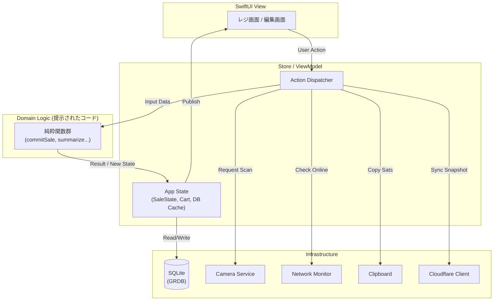

提示された「型定義」と「標準ロジック」は、アプリの **「脳（ドメインロジック）」** として**ほぼ100%完成**しています。
複雑な要件である「sats/現金の混在会計」「在庫の高水位管理」「状態遷移による販売制御」「グループ別集計」が、副作用のない純粋関数として実装されており、バグが混入する余地が極めて少ない素晴らしい設計です。

しかし、これだけでは「計算機」であり「アプリ」ではありません。
実際にMacBook Neo上で動作するシステムにするためには、以下の **「3つの層（UI・インフラ・永続化）」** が不足しています。

---

### 1. 不足している3つの層

#### ① UI層 (SwiftUI) - 「顔と手足」
ロジックは「状態（`SaleState`）」を返すだけなので、それを**画面に描画し、ユーザーの入力をロジックに変換する**ビューが必要です。
*   **レジ画面:** 商品パネル（グリッド）、カート（リスト）、合計表示、状態に応じたボタン制御（スキャン中は「会計へ進む」を押せない等）。
*   **編集画面:** グループ・種類・商品のフォーム、PIN入力モーダル。
*   **カメラUI:** `AVCaptureVideoPreviewLayer` の表示と、QR検出時のハイライト。
*   **ダイアログ:** 確認、エラー、中断時の警告表示。

#### ② インフラ層 (OS/Hardware API) - 「感覚器官」
MacBook NeoのハードウェアやOS機能と連携するコードです。ロジック層からは切り離し、プロトコル経由で注入する設計にします。
*   **カメラ (`AVFoundation`):** QRコードのスキャン処理（`AVCaptureMetadataOutput`）。
*   **クリップボード (`NSPasteboard`):** sats額のコピー。
*   **ネットワーク (`Network.framework`):** 接続状態の監視（sats払いの可否判定用）。
*   **セキュリティ (`Security.framework`):** PINとCloudflareシークレットのKeychain保存。
*   **ファイルI/O:** CSV/JSONのエクスポート、画像リソースの読み込み。
*   **システム制御:** スリープ無効化（`IOPMAssertionCreate`）、画面輝度調整。

#### ③ 永続化層 (Database) - 「記憶」
現在はメモリ上の配列（`[Product]`, `[Sale]`）を操作していますが、これらを**SQLite (GRDB.swift や SQLite.swift)** にマッピングするリポジトリ層が必要です。
*   **リポジトリ:** ロジックが要求する「配列」をDBから取得し、変更をDBに書き戻すアダプタ。
*   **マイグレーション:** スキーマ変更時のデータ移行管理。

---

### 2. 次にやること（P0フェーズ：技術検証）

ロジックは机上で検証済みなので、次は **「MacBook Neoという特殊環境で、インフラ層が本当に動くか」** を検証するP0フェーズに入ります。
以下の4つのスパイク（試作）を作成し、リスクを潰してください。

#### 検証メニュー

1.  **カメラとQRスキャン (AVFoundation)**
    *   **目的:** Neoのインカメラ（画面上部）で、手元の商品QRが読めるか検証。
    *   **実装:** `AVCaptureSession` を使い、プレビューを表示しつつ `AVCaptureMetadataOutput` でQR文字列を取得する最小コード。
    *   **確認点:** 焦点距離、照明の反射、映像の左右反転（ミラーモード）の影響。

2.  **状態遷移とUI制御 (SwiftUI + State)**
    *   **目的:** `SaleState` の変化に合わせて、画面のボタンや入力欄が正しく有効/無効になるか検証。
    *   **実装:** `@Observable` クラス（またはViewModel）で `SaleState` を保持し、ロジックの `commitSale` 等を呼び出す骨架UI。
    *   **確認点:** sats待ち画面からWoSへアプリを切り替え、戻ってきたときに状態が復元されるか。

3.  **クリップボード連携 (NSPasteboard)**
    *   **目的:** レジアプリからコピーしたsats額を、WoS（または別のアプリ）にペーストできるか検証。
    *   **実装:** `NSPasteboard.general.setString()` の呼び出し。
    *   **確認点:** WoSがMacアプリとして動く場合のユニバーサルクリップボードの挙動。

4.  **DB永続化 (GRDB.swift)**
    *   **目的:** メモリ上の `[Product]` をSQLiteに保存・復元できるか検証。
    *   **実装:** `Types.swift` の構造体に `FetchableRecord`, `PersistableRecord` を準拠させ、INSERT/SELECTを行う。
    *   **確認点:** `Date` 型や `Enum` のマッピング、トランザクション制御。

---

### 3. アーキテクチャの提案

ロジック（純粋関数）をUIから呼び出すための構成案です。

### 結論

**「型と標準ロジック」があれば、アプリの核心部分はできたも同然です。**
あとは、これを `SwiftUI` という「器」に入れ、`AVFoundation` や `GRDB` という「道具」を持たせるだけです。

**Next Action:**
まずは **P0-1（カメラとQRスキャン）** から着手してください。これがNeoでの運用の要（かなめ）であり、最大のリスクだからです。