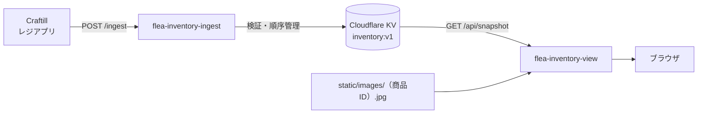

# flea-inventory-view

NOSTRASIA 2026 フリーマーケット「ものや」の商品と在庫を表示する、読み取り専用の Web サイトです。

- フレームワーク: SvelteKit（Svelte 5 / runes モード）
- スタイル: Tailwind CSS 4（`@tailwindcss/vite`）
- デプロイ先: Cloudflare Workers（`@sveltejs/adapter-cloudflare`）
- データ源: Cloudflare KV `inventory:v1`（[`flea-inventory-ingest`](../flea-inventory-ingest/) が書き込む）
- 言語: 日本語

レジアプリからは販売履歴や画像を送らず、**公開商品のスナップショットだけ**を受け取って表示します。サイト自体に書き込み機能はありません。

## 画面の機能

- 商品を「種類」ごとにまとめて一覧表示
- 種類ごとの在庫モードに応じた表示
  - `counted`: 「残り N個」
  - `unique`: 「1点もの」
  - `none`: 在庫バッジなし（SOLD OUT にならない）
- 在庫管理あり（`counted` / `unique`）で在庫 0 の商品は、画像の上に SOLD OUT スタンプを表示
- 「すべて / 在庫あり / SOLD OUT」の絞り込みと件数表示
- 価格の表示（円、`price_sats` がある場合は ⚡ sats も表示）
- 属性（色・素材など）をラベル付きで表示。空の属性は非表示
- 画像がない・読み込めない商品は、商品名と属性のテキスト表示にフォールバック
- 読み込み中のスケルトン、空一覧、取得エラー、再読み込みボタン
- スナップショットの `created_at` を日本時間で表示
- `/images/version.txt` があれば画像版を表示（任意）

画面右上の「再読み込み」は、成功後 **60秒間** 無効になります。取得に失敗した場合はクールダウンを解除するので、すぐ再試行できます。自動更新はありません。

### 開発時のデモ表示

`npm run dev` では KV を読めないことが多いため、`/api/snapshot` の取得に失敗すると `src/lib/demo-snapshot.ts` のテストデータで表示します。このとき画面に `DEV / テストデータ` のバッジが出ます。本番ビルドではデモデータに切り替わりません。

## データの流れ



`/api/snapshot` は KV の値をそのまま返します（`cache-control: no-store`）。KV が空の場合は `404` と `{}` を返します。

## ルーティング

| パス                   | 種類                   | 内容                                          |
| ---------------------- | ---------------------- | --------------------------------------------- |
| `/`                    | ページ                 | 商品・在庫の一覧（`src/routes/+page.svelte`） |
| `/api/snapshot`        | サーバーエンドポイント | KV からスナップショットを取得（読み取り専用） |
| `/images/<商品ID>.jpg` | 静的ファイル           | 商品画像。`static/images/` から配信           |
| `/images/version.txt`  | 静的ファイル（任意）   | 画像版の識別子。無くても動作する              |

## スナップショットの形

`src/lib/demo-snapshot.ts` に型定義（`Snapshot` / `SnapType` / `SnapProduct`）とデモデータがあります。

```json
{
	"created_at": "2026-11-29T12:34:56.789Z",
	"types": [
		{
			"type_id": "sticker",
			"name": "ステッカー",
			"stock_mode": "counted",
			"attr_labels": ["色", "模様"]
		}
	],
	"products": [
		{
			"product_id": "ST-001",
			"type_id": "sticker",
			"name": "ステッカー まる",
			"price_jpy": 300,
			"price_sats": 500,
			"attrs": ["黄", "まる"],
			"stock": 10,
			"has_image": true
		}
	]
}
```

- 受信側の ingest は `revision` も扱いますが、この画面では使用しません（型にも含めていません）。
- `stock_mode` は `counted` / `unique` / `none` の3種類です。
- `attrs` は `attr_labels` と同じ並びです。`null` や空文字は表示しません。
- 現在の画面は `has_image` を見て画像の有無を判断せず、`` の読み込み失敗時にフォールバックします。
- 商品は `types` の並び順でグループ化し、各グループ内は `product_id` の昇順で並びます。

## 開発

必要なもの: Node.js と npm

```sh
cd web/flea-inventory-view
npm install
npm run dev
```

`npm run dev` は Vite の開発サーバーです。KV が無い場合はデモデータで表示されます。

### npm スクリプト

| コマンド            | 内容                                                                 |
| ------------------- | -------------------------------------------------------------------- |
| `npm run dev`       | 開発サーバーを起動                                                   |
| `npm run check`     | `wrangler types --check`、`svelte-kit sync`、`svelte-check` で型検査 |
| `npm run lint`      | Prettier のチェックと ESLint                                         |
| `npm run format`    | Prettier で整形                                                      |
| `npm run build`     | 型定義のチェック後に本番ビルド                                       |
| `npm run preview`   | ビルド済み Worker を `wrangler dev` で確認（ポート 4173）            |
| `npm run gen`       | `worker-configuration.d.ts` を再生成                                 |
| `npm run test:unit` | Vitest（watch モード）                                               |
| `npm test`          | Vitest を1回実行し、続けて Playwright の E2E                         |

テストは Vitest の `client`（Playwright / Chromium のブラウザテスト）と `server`（Node）の2プロジェクト構成です。`src/lib/vitest-examples/` と `src/routes/page.svelte.e2e.ts` はプロジェクト作成時のサンプルで、E2E は `h1` が表示されることだけを確認しています。

### 本番に近い形で確認する

```sh
npm run check
npm run build
npm run preview
```

`npm run preview` は `.svelte-kit/cloudflare/_worker.js` を `wrangler dev` で起動します。ローカルの KV が空だとエラー表示になり、`dev` ではないためデモデータには切り替わりません。

## ビルドとデプロイ

```sh
cd web/flea-inventory-view
npm ci
npm run build
npx wrangler deploy
```

- `vite build` の出力は `.svelte-kit/cloudflare/` です。`wrangler.jsonc` の `assets.directory` も同じ場所を指しています。
- `npm run build` の最初に `wrangler types --check` が走ります。バインディングを変えたときは `npm run gen` で `worker-configuration.d.ts` を更新してください。
- `.svelte-kit/` と `.wrangler/` は生成物です。直接編集しないでください。

### KV バインディング

`wrangler.jsonc` で `INVENTORY_KV` をバインドしています。

```jsonc
"kv_namespaces": [
  { "binding": "INVENTORY_KV", "id": "<KV ネームスペース ID>" }
]
```

ingest Worker と**同じ KV ネームスペース ID** を指定してください。別の Cloudflare アカウントへデプロイする場合は、両方の `wrangler.jsonc` を自分の ID に置き換えます。

型は `src/app.d.ts` の `App.Platform.env.INVENTORY_KV` と、`cloudflare:workers` の `env` で参照しています。

## 商品画像

- `static/images/<商品ID>.jpg` を配置します（例: `MNKH-01.jpg`）。
- 画面は `/images/<商品ID>.jpg` を参照します。画像が無い場合は読み込みエラーでテキスト表示に切り替わります。
- 画像を追加・差し替えたら、**再ビルドと再デプロイ**が必要です。デプロイ済みのサイトはローカルのファイル変更を自動では反映しません。
- `static/images/version.txt` は任意です。存在すれば画面に「画像版 ...」と表示されます。生成はリポジトリ直下の `scripts/build_images.py` が行います。
- `static/` は Prettier の対象外です（`.prettierignore`）。

## 構成

```text
flea-inventory-view/
├── src/
│   ├── app.d.ts                     # App.Platform の KV 型
│   ├── app.html                     # HTML テンプレート
│   ├── lib/
│   │   ├── demo-snapshot.ts         # スナップショット型 + 開発用デモデータ
│   │   └── vitest-examples/         # サンプルのユニットテスト
│   └── routes/
│       ├── +layout.svelte           # 共通レイアウト（CSS・favicon）
│       ├── +page.svelte             # 在庫一覧ページ
│       ├── layout.css               # Tailwind テーマ・フォント・マーキー
│       ├── api/snapshot/+server.ts  # KV 読み取り API
│       └── page.svelte.e2e.ts       # E2E テスト
├── static/
│   ├── images/                      # 商品画像（<商品ID>.jpg）
│   └── robots.txt                   # AIクローラー拒否
├── worker-configuration.d.ts        # wrangler が生成するバインディング型
├── wrangler.jsonc                   # Worker 名・KV・アセット設定
├── vite.config.ts                   # SvelteKit・Tailwind・Vitest 設定
├── playwright.config.ts             # E2E 設定（build + preview を起動）
├── prettier.config.js               # タブ、シングルクォート、100桁
└── eslint.config.js                 # ESLint + Prettier 連携
```

## 実装メモ

- ページは Svelte 5 の runes（`$state` / `$derived`）で書かれています。`vite.config.ts` で `node_modules` 以外を runes モードに固定しています。
- 配色・フォントは `src/routes/layout.css` の `@theme` で定義しています（レモン色・紙色・インク色など）。Google Fonts は `+page.svelte` の `<svelte:head>` で読み込みます。
- イベント名、日時、会場、支払い方法、公式リンクなどの文言は `src/routes/+page.svelte` に直接書かれています。別のイベントで再利用する場合はここを書き換えてください。
- SNS のリンクプレビュー用に OGP / Twitter Card を `+page.svelte` の `<svelte:head>` に設定しています。`og:image` は `static/images/MNST-01.jpg` を使っています。
- `src/routes/api/snapshot/+server.ts` は読み取りのみで、認証や CORS はありません。同一オリジンのページから呼ぶ前提です。
- KV は結果整合なので、レジで会計した直後は少し古い在庫が表示されることがあります。
- `robots.txt` は検索エンジンとSNSのクロールを許可し、AIクローラー（GPTBot、ClaudeBot、CCBot、PerplexityBot など）だけを拒否しています。

## 関連

- リポジトリ全体の説明: [`../../README.md`](../../README.md)
- スナップショット受信 Worker: [`../flea-inventory-ingest/`](../flea-inventory-ingest/)
